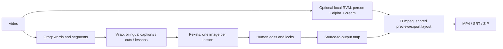

# System map — Vietnamese with Vinh / VietCut

This is the entry point for future agents. Read `AGENTS.md` as well. Update this map alongside architecture or behavior changes.

## Runtime and existing architecture

- Windows, Python 3.11+, React/TypeScript + Vite, FastAPI, SQLite, Pillow/OpenCV and FFmpeg with libass.
- `MO_VIETCUT.cmd` starts `start.py`; the browser opens on localhost using APP_PORT from `.env` (8876 on this installation).
- `backend/config.py`: workspace/data directories and server-only environment configuration.
- `backend/store.py`: SQLite projects/jobs, atomic JSON, per-project folders and revision persistence.
- `backend/app.py`: local HTTP API, upload/import/export, optimistic plan revisions, SSE and media Range responses.
- `backend/worker.py`: one durable background queue; resumes incomplete jobs at startup and supports cancellation.
- `backend/providers.py`: Groq STT (300-second chunks), Vilao planning (120-second windows), Pexels search and asset download.
- `backend/timeline.py`: schemas, validation, cut merging and source/output time mapping.
- `backend/render.py`: legacy rendering, chunk caching, audio assembly and subtitles.
- `frontend/src.tsx`, `frontend/style.css`: local editor. `tests/`: offline behavioral and render tests. `scripts/`: opt-in live acceptance/diagnostic tools.

## Data flow



## Lesson-frame architecture (v1.1)

- `backend/lessons.py`: second AI pass for semantic learning targets, cross-window context, normalization/coverage, locked intervals and one Pexels image per target. `lesson_key` preserves Vietnamese diacritics. Never equate ma/má/mà.
- `backend/templates.py`: shared normalized geometry, brand/paper artwork, bundled Noto fonts, strict text fitting, face-aware speaker positioning. `assets/frame_brand.json` is the single brand/color source; `assets/fonts/` contains Noto Sans and Noto Serif with their OFL licenses.
- `backend/lesson_render.py`: static lesson pages + rounded speaker video + subtitle PNG overlays INSIDE the speaker tile. A lesson continues across 20-second render chunks and source cuts; image/text never pan or zoom. New pages fade only at real lesson transitions.
- `backend/render.py`: dispatches by `options.layout_mode`; retains the original renderer for legacy projects. Source audio, SRT timestamps and cuts share existing mapping helpers.
- `frontend/LessonEditor.tsx`: lesson list and fields. `frontend/src.tsx` owns split/merge/delete/boundary changes, photo selection, revision saving and explicit conversion. Editing a boundary updates its neighbor so coverage remains continuous.

### Contracts and compatibility

`Plan.schema_version=1` is the existing format. Version 2 adds `lessons` and requires complete, ordered, non-overlapping coverage from source second 0 through source duration.

```json
{
  "schema_version": 2,
  "summary": "Chào hỏi",
  "glossary": [], "cuts": [], "captions": [], "visuals": [],
  "lessons": [{
    "id": "lesson-0-0", "start": 0, "end": 60,
    "vi": "Xin chào", "en": "Hello", "chunks": [],
    "photo_query": "people greeting in Vietnam", "asset_id": null,
    "locked": false
  }]
}
```

`chunks` has at most three `{vi,en}` entries. `captions` remain independently timed spoken subtitles; lesson text is the teaching target, not all spoken instructions. The opening holds the first target and the ending holds the last. Adjacent occurrences of the same target are merged across AI windows. A non-adjacent recurrence can reuse its image. Locked lesson content AND exact intervals override AI proposals.

Options include `layout_mode` (`legacy`/`lesson`), nullable `speaker_x`/`speaker_y` in source fractions 0..1 and `speaker_scale` (0.65..1.5). Old/missing options decode to legacy. New project creation sets lesson mode unless the caller explicitly requests legacy. This distinction is intentional: do not change the global default and accidentally migrate existing ZIPs/projects.

### API and durable jobs

- `POST /api/projects` / `/api/projects/sample`: new lesson-mode projects, unless explicitly overridden.
- `PUT /api/projects/{id}/plan`: full plan + options + expected revision; validates coverage, assets and export-size text fitting before saving and queuing preview. Conflicts return 409.
- `POST /api/projects/{id}/reframe`: queues `reframe`; uses the saved transcript and existing captions/cuts, plans lessons and downloads illustrations. Saves old layout in history before committing the converted plan. If already converted, queues only preview so a failed render can be retried without additional AI calls. Existing projects never convert on read, startup or import.
- `POST /api/projects/{id}/revise`: generates an AI revision; both old caption/cut locks and new lesson locks are respected.
- Preview/export jobs use the same renderer/geometry. SSE, cancellation, versions, restore and ZIP import/export remain shared. ZIP includes source, transcript, assets, frame thumbnails and versions; generated lesson tiles are regenerated locally.

Pipeline order: frame extraction → cached/new STT → original bilingual-caption/cut analysis → semantic lesson pass (120-second windows with previous target) → per-target image selection → text preflight → revision save → preview. The temporary short visuals from the original pass are discarded in lesson mode. `reframe` skips the original caption/cut pass, preserving all manual edits, including unlocked caption edits.

### Geometry and rendering invariants

- Portrait reference: 1080×1920; speaker near the top at about 30% height, target text in the middle, illustration below. Landscape: 1920×1080; speaker about 1/3 width on the left, content and illustration on the right.
- Branding is small, exactly “Vietnamese with Vinh”. Fixed cream/teal/orange/gold palette, deterministic paper texture and rounded corners.
- Font sizes adapt without ellipsis. Text that cannot fit at the minimum legible size fails with a user-facing shorten/split message. Subtitle PNG dimensions are constrained to the bottom 34% of the speaker tile; the face crop reserves headroom and mouth clearance. Speaker settings allow manual correction.
- Images are contained over a blurred fill, preserving all subjects. No image creates a full-screen replacement of the frame. Missing images use a neutral teaching card and a warning; user can choose Pexels or their own image.
- All source cuts remain inward-aligned to 30-fps boundaries. Intermediate chunks use PCM audio to avoid accumulating AAC delay. Final output is H.264 + AAC stereo.
- Lesson cache identity includes the render version, lesson-render version, template/font/brand content signature, chosen image bytes, speaker focus, plan, options and music. A change to rendering behavior MUST bump its version. A cosmetic template change must invalidate the template signature/version.
- On an identical-content cache hit, return the caller's current project revision in result metadata. Keep the immutable file/manifest content unchanged. Returning the original manifest revision falsely marks a correct reused preview as outdated after restoring/switching layouts.

## Background removal (v1.2)

- `backend/matting_schema.py`: portable `options.background_removal={enabled,device,soften,contract,strokes}`. Each stroke has id, source start/end, keep/remove, normalized radius and normalized points. Finite/bounded validation and duration checks apply on create/save/restore/import. Missing config decodes OFF; only NEW creation defaults ON. Reading old projects does not mutate them.
- `backend/matting.py`: orchestration, source/model SHA-256 verification, cache identity, runtime readiness, cancellable subprocess, source-time composition and original-audio mux. Torch/CUDA are NEVER imported into the app process. GPU unavailable is an explicit error with CPU/off choices, never implicit CPU fallback.
- `scripts/matting_runner.py`: bounded 1MB Windows pipes (not whole-video buffers), single filter threads, optional NVENC encoding to reduce CPU load; isolated Python process, official RVM MobileNetV3 v1.0.0 TorchScript, FP16 CUDA / explicit FP32 CPU. First frame uses 4D to initialize state (official v1 script cannot initialize from a 5D batch); subsequent batches are four sequential frames. GPU OOM retries one at a time without discarding recurrent state. Working long side <=1920, internal <=512, CFR30.
- Each source-time 600-frame segment commits only after foreground H.264 yuv444p QP16 NVENC (CRF16 CPU encoding fallback), lossless gray FFV1 alpha, cream H.264 composition, four recurrent tensors in safe NPZ, tracking state and completion JSON are successfully written. Resume restores the contiguous prefix and model state; it does not reset every 20 seconds. Unfinished segments are overwritten. Source timestamps remain authoritative; render cuts are applied AFTER matting.
- Keep/remove strokes propagate FORWARD using pyramidal optical flow at <=640px. Forward/backward error, tracking status, bounds and scene histogram checks gate confidence. An unreliable stroke stops until another user mark, with source-time warning. Correction state and previous grayscale image are checkpointed across segments. Held objects are outside the intended preservation requirement.
- `backend/worker.py:prepared_render`: matting before rendering, persists result metadata, passes ephemeral render_source_file to either renderer. Stored source_file and source recording stay intact. Audio is muxed from original source before existing cuts/audio processing. Lesson/photo/subtitle logic stays shared. Matting code is part of lesson render/chunk identity; explicit matting code in both manifest/chunk identities handles legacy rendering too.
- `frontend/MattingPanel.tsx`: explicit enable/device, status, edge controls, before/after video, source-frame keep/remove canvas, correction end time, remove-stroke, black/white/cream checks and speed/warning readout. Global save/revision/history machinery persists options. Current source-time mapping drives marking even when viewing a cut preview.
- `GET /api/matting/status`: isolated runtime/GPU and verified model readiness. `GET /api/projects/{id}/matting/frame?time=&before=&background=`: bounded source-time PNG from original or committed paired layers; never initiates inference. Dirty controls require Save before the after image changes. Paired layers are trimmed by exact frame index within the committed segment: timestamp seeking across H.264/FFV1 time bases can silently produce a blank overlay near segment ends.
- Cache path `data/projects/<id>/matting/<sha>/`; digest includes source bytes, pinned model bytes, processor version, working size, brand paper, edges and strokes. It excludes ratio/lessons/photos/subtitles/cuts: all use the same person/alpha/composition. Edge/brush changes currently recompute inference for their distinct digest (no independent raw-layer reuse yet).
- `scripts/setup_matting.py` / `CAI_DAT_XOA_PHONG.cmd`: isolated `data/runtime/matting`, torch2.8.0 cu128 + numpy2.2.6/OpenCV4.12; official models pinned by SHA-256 under `data/runtime/models`. Does not alter global CPU Torch. GPL source/license/attribution in assets/licenses; see HUONG_DAN_GPU.md. Runtime/models/masks never belong in Git or ZIP. ZIP exports only configuration/strokes; import drops generated matting metadata and regenerates.
- `tests/test_matting.py`: default/compatibility, time/brush bounds, cache invalidation/reuse, no silent CPU fallback, checksum rejection, optical-flow confidence, tracking checkpoint continuity, full-frame pipe transfer, simulated OOM recurrence, exact-frame boundary previews, ZIP config round trip. `scripts/acceptance_matting.py` opt-in actual GPU test creates a separate clone of an existing lesson project without provider calls; checks cancellation/resume, both aspect exports, full FFmpeg decode, source/project preservation and three-background snapshots. Quality approval remains pending user review.

## Where to change a feature

| Need | Primary locations | Verification |
| --- | --- | --- |
| Branding, colors, region positions, fonts | frame_brand.json, templates.py | both ratios, Vietnamese text, long sentences |
| AI grouping or keeping an image across practice | lessons.py | boundary 120s, repeat targets, exact locked regions |
| Speaker crop, subtitles, transition or video output | lesson_render.py, templates.py | speaker containment, decode, boundary 20s, cache invalidation |
| Lesson editing / photo UI | LessonEditor.tsx, src.tsx | add/split/merge/delete, neighbor boundaries, save conflict |
| Plan data or conversion | timeline.py, app.py, worker.py | v1 compatibility, v2 ZIP, conversion history, rollback |
| Provider errors or media retrieval | providers.py | retries, missing-image fallback, no credentials in responses |

## Storage and recovery

`data/studio.sqlite` stores project JSON and jobs. Each `data/projects/<id>/` contains the copied source, transcript/audio caches, analysis caches, assets, frame samples, version snapshots, immutable renders, render-cache chunks and generated `lesson-tiles`. SQLite is authoritative for the current plan/options. Completed cache markers are written only after FFmpeg succeeds. Never reuse partial chunks without their completion marker. Cancelled work keeps completed stages; startup requeues interrupted running jobs.

The checked-in tests are offline and never bill APIs. `scripts/acceptance_lessons.py` is an opt-in live sample acceptance; it creates a separate project, exports both ratios, round-trips v2 ZIP, converts a disposable imported v1 copy and verifies the original projects are byte-for-byte unchanged. Scripts for earlier delivery are installation-specific diagnostics, not startup dependencies.

## Operational rules

Keep source audio/video on disk intact. Work against a separate demo project when validating new rendering. Do not convert the two existing user projects automatically.

Use `python -X utf8 -m unittest discover -s tests -v` and `npm run build`. Live provider tests require the user's `.env` and use API quota. The 60-minute test is simulated; do not claim a full-hour Full HD benchmark unless one was actually run.

Only code, blank configuration, documentation, licensed template/font assets and tests belong on GitHub. `.env`, data, OUTPUT, original recordings and caches stay local. Run `python scripts/verify_staged.py` after staging; it scans Git index paths and bytes, without printing key values. Commit and push completed tested changes to main, then compare local HEAD to `git ls-remote origin refs/heads/main`. Never force-push. If blocked by auth/network, keep the local commit and report incomplete synchronization.

## Troubleshooting

- No lessons tab on an old project: expected; use its explicit conversion button.
- Image disappears mid-lesson: inspect semantic coverage and `mapped_lessons`; do not tie content lifetime to subtitle cues or chunk boundaries.
- Missing face/head/mouth: inspect sampled face boxes, speaker focus and manual x/y/scale controls; preserve subtitle clearance.
- Text overflow: shorten/split the lesson or remove overlong explanatory chunks. Never restore silent truncation.
- Old visual appears after changing theme/asset: inspect template/file content hashes and render-version invalidation.
- API error: inspect job's sanitized error; check .env using the settings UI. Never paste credentials into logs or reports.
- Current limits: source up to 60 minutes; full-hour orchestration has simulated coverage, not a measured one-hour Full HD performance guarantee.
