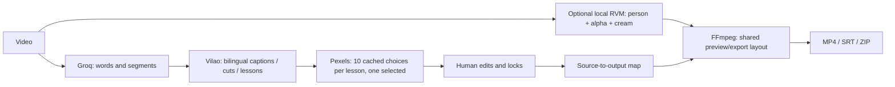

# System map — Vietnamese with Vinh / VietCut

This is the entry point for future agents. Read `AGENTS.md` as well. Update this map alongside architecture or behavior changes.

## Runtime and existing architecture

- Windows, Python 3.11+, React/TypeScript + Vite, FastAPI, SQLite, Pillow/OpenCV and FFmpeg with libass.
- `MO_VIETCUT.cmd` starts `start.py`; the browser opens on localhost using APP_PORT from `.env` (8876 on this installation).
- `backend/config.py`: workspace/data directories and server-only environment configuration.
- `backend/store.py`: SQLite projects/jobs, atomic JSON, per-project folders and revision persistence.
- `backend/app.py`: local HTTP API, upload/import/export, optimistic plan revisions, SSE and media Range responses.
- `backend/worker.py`: one durable background queue; resumes incomplete jobs at startup and supports cancellation.
- `backend/providers.py`: Groq STT (300-second chunks), Vilao planning (120-second windows), Pexels search and asset download.
- `backend/timeline.py`: schemas, validation, cut merging and source/output time mapping.
- `backend/render.py`: legacy rendering, chunk caching, audio assembly and subtitles.
- `frontend/src.tsx`, `frontend/style.css`: local editor. `tests/`: offline behavioral and render tests. `scripts/`: opt-in live acceptance/diagnostic tools.

## Windows Start Menu launcher

- `TAO_BIEU_TUONG_START.cmd` invokes `scripts/install_start_shortcuts.py` using .venv Python when present, otherwise the installed Python. It creates **Vietnamese with Vinh.lnk** in the workspace root and personal Start Menu Programs via native WScript.Shell COM; `--verify` reads both links back without saving. Target is that environment's pythonw.exe, with the fully quoted absolute `launch_vietcut.pyw` argument, workspace WorkingDirectory and assets/vietcut.ico. Paths are passed as JSON through a child environment variable, never inserted into shell code. No execution-policy, registry pinning, admin rights or auto-login startup changes. User chooses Pin to Start through the normal Windows menu.
- `launch_vietcut.pyw` sets CWD from its own path, supplies UTF-8 stdout/stderr streams BEFORE loading Uvicorn and restores them on exit. pythonw otherwise has None streams, which can break Uvicorn logging. Startup/error output goes to ignored data/logs/launcher.log; startup failures show a generic Windows message with the log path, no key values.
- `start.py` is shared by the visible .cmd and hidden shortcut. Probe loopback health and require app= vietcut before opening the browser; no provider/network calls. A per-data-directory/port OS file lock serializes rapid launches and stays held for server lifetime. Another click waits for readiness and reopens the local browser instead of binding again. Validate APP_PORT, require the built frontend for cold start, listen only on 127.0.0.1. Closing the browser does not terminate background work.
- `assets/vietcut.ico` is a bundled multiresolution V/play icon generated by scripts/make_launcher_icon.py. Generated .lnk files contain machine-specific paths: ignore them and reject them in verify_staged.py. Commit the installer/icon/source, not installed shortcuts. Regenerate links after moving the workspace or changing Python.
- `tests/test_start.py` covers app identity, existing-server reuse, invalid port/missing build, rapid-click waiting, lock exclusion/release and loopback cold-start behavior. Actual Windows acceptance additionally creates/reads both shortcuts, cold-starts via the .lnk, confirms pythonw/no main window and checks a repeated hidden launch from another directory exits successfully. Evidence stays in OUTPUT/launcher/.

## Data flow



## Lesson-frame architecture (v1.1)

- `backend/lessons.py`: second AI pass for semantic learning targets, cross-window context, normalization/coverage, locked intervals and one Pexels image per target. `lesson_key` preserves Vietnamese diacritics. Never equate ma/má/mà.
- `backend/templates.py`: shared normalized geometry, brand/paper artwork, bundled Noto fonts, strict text fitting, face-aware speaker positioning. `assets/frame_brand.json` is the single brand/color source; `assets/fonts/` contains Noto Sans and Noto Serif with their OFL licenses.
- `backend/lesson_render.py`: static lesson pages + rounded speaker video + subtitle PNG overlays (portrait photo / landscape speaker, see v1.4). A lesson continues across 20-second render chunks and source cuts; image/text never pan or zoom. New pages fade only at real lesson transitions.
- `backend/render.py`: dispatches by `options.layout_mode`; retains the original renderer for legacy projects. Source audio, SRT timestamps and cuts share existing mapping helpers.
- `frontend/LessonEditor.tsx`: lesson list and fields. `frontend/src.tsx` owns split/merge/delete/boundary changes, photo selection, revision saving and explicit conversion. Editing a boundary updates its neighbor so coverage remains continuous.

### Contracts and compatibility

`Plan.schema_version=1` is the existing format. Version 2 adds `lessons` and requires complete, ordered, non-overlapping coverage from source second 0 through source duration.

```json
{
  "schema_version": 2,
  "summary": "Chào hỏi",
  "glossary": [], "cuts": [], "captions": [], "visuals": [],
  "lessons": [{
    "id": "lesson-0-0", "start": 0, "end": 60,
    "vi": "Xin chào", "en": "Hello", "chunks": [],
    "photo_query": "people greeting in Vietnam", "asset_id": null,
    "locked": false
  }]
}
```

`chunks` has at most three `{vi,en}` entries. `captions` remain independently timed spoken subtitles; lesson text is the teaching target, not all spoken instructions. The opening holds the first target and the ending holds the last. Adjacent occurrences of the same target are merged across AI windows. A non-adjacent recurrence can reuse its image. Locked lesson content AND exact intervals override AI proposals.

Options include `layout_mode` (`legacy`/`lesson`), nullable `speaker_x`/`speaker_y` in source fractions 0..1 and `speaker_scale` (0.65..1.5). Old/missing options decode to legacy. New project creation sets lesson mode unless the caller explicitly requests legacy. This distinction is intentional: do not change the global default and accidentally migrate existing ZIPs/projects.

### API and durable jobs

- `POST /api/projects` / `/api/projects/sample`: new lesson-mode projects, unless explicitly overridden.
- `PUT /api/projects/{id}/plan`: full plan + options + expected revision; validates coverage, assets and export-size text fitting before saving; optional render_preview defaults true, live UI passes false. Conflicts return 409.
- `POST /api/projects/{id}/reframe`: queues `reframe`; uses the saved transcript and existing captions/cuts, plans lessons and downloads illustrations. Saves old layout in history before committing the converted plan. If already converted, queues only preview so a failed render can be retried without additional AI calls. Existing projects never convert on read, startup or import.
- `POST /api/projects/{id}/revise`: generates an AI revision; both old caption/cut locks and new lesson locks are respected.
- Preview/export jobs use the same renderer/geometry. SSE, cancellation, versions, restore and ZIP import/export remain shared. ZIP includes source, transcript, assets, frame thumbnails and versions; generated lesson tiles are regenerated locally.

Pipeline order: frame extraction → cached/new STT → original bilingual-caption/cut analysis → semantic lesson pass (120-second windows with previous target) → per-target image selection → text preflight → revision save → preview. The temporary short visuals from the original pass are discarded in lesson mode. `reframe` skips the original caption/cut pass, preserving all manual edits, including unlocked caption edits.

### Geometry and rendering invariants

- Portrait reference: 1080×1920; photo top (46,96,988,566), target middle (46,692,988,484), speaker bottom (46,1208,988,570), preserving ~30% speaker height and bottom breathing room. Landscape keeps the left speaker/right teaching content geometry.
- Branding is small, exactly “Vietnamese with Vinh”. v1.4 uses flat beige #F7F3EB, white cards #FFFFFF, pastel #DCEAF4, navy #163247, secondary #456479, border #DCE4E8; no large colorful ornaments or blur. Theme lives in assets/frame_brand.json.
- Font sizes adapt without ellipsis. Text that cannot fit at the minimum legible size fails with a user-facing shorten/split message. Portrait subtitles overlay the lower photo region; landscape subtitles stay in the speaker region. subtitle_region/subtitle_position are shared by PNG preview/export. Face-aware crop and manual speaker controls remain shared.
- Lesson-frame images cover their illustration rectangle without blur or stretching. Overflow is cropped using the ratio-specific photo_crops. Speaker padding is flat brand cream, never a blurred duplicate. Missing images use a neutral teaching card and warning; legacy layouts retain their previous behavior.
- All source cuts remain inward-aligned to 30-fps boundaries. Intermediate chunks use PCM audio to avoid accumulating AAC delay. Final output is H.264 + AAC stereo.
- Lesson cache identity includes the render version, lesson-render version, template/font/brand content signature, chosen image bytes, speaker focus, plan, options and music. A change to rendering behavior MUST bump its version. A cosmetic template change must invalidate the template signature/version.
- On an identical-content cache hit, return the caller's current project revision in result metadata. Keep the immutable file/manifest content unchanged. Returning the original manifest revision falsely marks a correct reused preview as outdated after restoring/switching layouts.

## Pastel live editor and retention (v1.4)

- templates.py template v3 / lesson_render.py lesson renderer v5: portrait photo above, target in middle, speaker below (~30%); subtitle over the bottom of the TOP photo with translucent navy background. Landscape layout stays fixed and gets the same pastel theme. Inner boxes round to nearest pixel, without forcing even widths, so half-size preview keeps exact proportional placement; only H.264 canvas dimensions are even. Fonts are cached (128 entries); static page and subtitle functions can return Pillow images in memory for the live API without writing a file. Old exports/versions are not overwritten; legacy rendering still dispatches separately.
- `backend/live_preview.py`: read-only draft scene. `POST /api/projects/{id}/preview-scene` accepts sequence, a current draft lesson/caption and options, including temporarily empty text. Returns preview dimensions, geometry, identical speaker crop/pad transform, page/subtitle PNG data URLs, subtitle rectangle and unburned source selection/status. Assets must belong to the project. PNGs use the same Pillow functions/fonts as export; RAM LRU is bounded to 64 entries AND 24 MiB. No revisions, files, jobs, STT or providers are written/called while editing. Invalid/overflow text returns an error so the editor keeps its most recent valid frame and shows a warning.
- `frontend/LivePreview.tsx` composes the static PNG page, clipped source/composited speaker video and independent subtitle PNG. Uses SOURCE time, skips enabled source cuts, and updates captions/lessons at frame checks. Crop/position geometry is server authoritative, not a second text-layout implementation. Same-lesson caption edits do not change the photo/page cache. Normal edits coalesce for 100ms; a playback cue boundary requests immediately to reduce subtitle lag. `preview_requests.ts` cancels/disposes pending work and suppresses obsolete successes/errors even when an old request completes after abort. Built-in Node tests cover coalescing/out-of-order/unmount behavior without a browser dependency.
- Lesson editor Save sends `render_preview:false`. SavePlan and history RestoreBody default this optional flag to true for backward compatibility. Saving records history/revision but does not require an MP4 job; export remains explicit and uses saved data. The main preview switches between original source and live composition. Existing MP4s remain downloadable with their original revision metadata. Live audio is source speech; final loudness/music/SFX processing remains in export.
- Matting layer identity now excludes paper color. Completed v2 layer pairs may be adopted by comparing source bytes/model/config/size/fps/network/version, ignoring only paper. No original cache files are rewritten. New color-specific composition hashes include layer key + paper + composition version. Recolor uses committed foreground/gray alpha through FFmpeg, original audio, per-segment completion markers and a final manifest. Result exposes layer_code separately from color-specific code; comparison-frame API reads layer_code. GPU runtime is not initialized for a valid layer cache hit.
- `prepare_speaker` is a durable job to ensure/recolor the unburned source without generating a whole lesson MP4. Live source_info reports pending when matting/config/paper is stale or unavailable; it never presents an old composition as current. UI attempts preparation once per saved revision while idle/clean; failures have explicit retry and existing GPU/CPU/off controls, never silent CPU fallback.
- `backend/retention.py`: LIMIT30 / DAYS7, creation-date ordering (fallback updated_at for old missing dates), excludes diagnostics and queued/running/cancelling projects. Sweep after create/import, task completion, startup and hourly while app runs. If all candidates are busy, >30 is temporary. Import gets a new local created_at and preserves origin_created_at; imported retention/diagnostic flags are discarded. Recovered project is protected for that sweep and retains its original creation date.
- Retention JSON journal states active/archiving/trashed/restoring/purging under _retention. Move whole data/projects/<id> to data/trash/<id>; never touch files outside the project. Persist intent before moving/deleting; startup can complete interrupted operations. A Windows rename failure before movement rolls back to active so open files cannot hide an unmoved project. Purge only after a valid >=7-day deadline; no date means do not purge. Validate resolved root, IDs, direct and nested symlink/junction/reparse attributes BEFORE every recursive purge, then recheck target immediately before rmtree. Database/jobs are removed after filesystem deletion succeeds. Unsafe/locked paths stay with warnings for later diagnosis/retry.
- `store.read()` and `folder()` reject archived projects with TrashedProject (HTTP410), do not recreate their directories; job_create also rejects them. listing() omits trash by default; internal include_trashed exposes recovery records. SSE emits trashed and closes if a currently open project is moved. Frontend keeps its dirty draft, disables mutations and offers restore; after restore it reconnects and retains unsaved content. `GET /api/trash` and `POST /api/trash/{id}/restore` serve the 7-day Trash page. Restoration while full moves another oldest eligible project to trash.
- Verification: test_live_preview (read-only API/template equality/save without job/empty edits/latency), test_retention (29/30/31/busy/diagnostic/7 days/restore/crash states/rename failure/real Windows junction rejection in temp directories), matting palette reuse regression, node --test tests/preview_requests.test.mjs. scripts/acceptance_pastel.py clones a sample project, reuses old layers, measures warm API responses, exports both aspects, compares reconstructed live frames against export, and verifies original plan/options/assets/revisions. Tests that remove data MUST use a separate TemporaryDirectory, never actual user projects.

## Flat frames and ten-image sets (v1.3)

- `backend/templates.py` template v2 / `backend/lesson_render.py` lesson renderer v4 remove blurred speaker extensions and contain-over-blur photos. Speaker focus/scale, thin rounded border, subtitle clearance and region geometry are unchanged. Pad the original/composited speaker once onto solid brand cream. This does not change the matting processor or its cache digest.
- `backend/photo_layout.py` is the authoritative cover geometry. Scale uniformly to fill, multiply zoom 1..3, round scaled dimensions upward, then crop the overflow at normalized x/y 0..1 (default .5). Both `make_frame` and the editor's GET photo-layout use it; no blur, letterbox or distortion. Template, tile and chunk identities include crop state and bumped versions.
- Optional Lesson fields: `photo_candidates` (0..10 distinct asset IDs) and `photo_crops` (`9:16` / `16:9` → finite x,y in 0..1, zoom in 1..3). Missing fields default empty, preserving v2 compatibility. Original aspect uses the portrait/landscape crop key according to source dimensions. Frontend selection of a different image clears both crops; each ratio otherwise keeps its own crop. Save/restore/import validate referenced candidate assets; snapshots and ZIP retain the fields and all local image assets.
- `backend/photo_pools.py`: per semantic vi/en/query key, search up to two pages of 30 Pexels candidates, remove duplicate IDs, rank with Vilao (first ten thumbnails when vision is available, metadata for remaining candidates), then download ten successful distinct choices. Default is the first ranked downloaded image; never overwrite an existing selected/locked image merely to prepare or refresh a set. Repeated same targets reuse the set without another provider call. New/revised lesson pipelines prepare sets; opening existing projects never does so.
- Resumable manifests live in analysis/photo-pools/<target>/<generation>/pool.json; atomically persist ranking and every downloaded asset. Cancellation preserves committed downloads. A refresh has a new generation, excludes the currently shown set/selection, preserves the selected image and can retry the same generation. Failed downloads try remaining ranked candidates; an insufficient set reports its actual count. Empty/error results keep the previous pool and selected image. Provider failures remain sanitized. Downloaded JPG files are committed via temporary files and decoded/EXIF-normalized before use.
- `POST /api/projects/{id}/lessons/{lesson_id}/photo-candidates` takes `{revision,refresh:false}` and queues durable `lesson_photos`; stale revisions return 409. `POST /api/jobs/{job_id}/retry` retries only failed/cancelled photo jobs with the same request/generation. The worker versions a changed plan, saves assets/set and regenerates preview from existing matting; rendering does not redo STT or lesson analysis. `GET /api/projects/{id}/photo-layout?asset_id=&ratio=&zoom=` returns frame/scaled sizes and overflow from shared geometry; it never contacts providers.
- `frontend/PhotoCrop.tsx` displays those exact proportions for drag, position sliders, zoom and reset. `LessonEditor.tsx` shows local thumbnails, count, selected state, prepare/supplement/refresh actions and existing search/upload. Save is required before starting a set task and after changing selection/crop. Local choice requires no network beyond localhost. Cancelling a photo task exposes retry.
- Pexels manual search now returns ten results; legacy automated asset selection keeps its six-result default. The API key stays server-side. Photographer names and existing Pexels links remain visible; export credits list only actually selected assets. Provider endpoint parameters follow https://www.pexels.com/api/documentation/ .
- `tests/test_photo_pools.py`: source aspect/cover/zoom, crop rendering, old defaults, bounds, AI ID filtering, duplicate/partial sets, network errors, cancel/resume, refresh exclusion, recurrence with locked selections, offline choice, API revision checks, ZIP/history round trips. Speaker flat padding is a real FFmpeg render regression in test_lesson_render. `scripts/acceptance_photo_frames.py` is opt-in live Pexels/Vilao acceptance on a separate clone, reusing committed matting and checking both full exports, actual ten JPGs, refresh, source-project preservation and ZIP image hashes. It does not run Groq again.

## Background removal (v1.2)

- `backend/matting_schema.py`: portable `options.background_removal={enabled,device,soften,contract,strokes}`. Each stroke has id, source start/end, keep/remove, normalized radius and normalized points. Finite/bounded validation and duration checks apply on create/save/restore/import. Missing config decodes OFF; only NEW creation defaults ON. Reading old projects does not mutate them.
- `backend/matting.py`: orchestration, source/model SHA-256 verification, cache identity, runtime readiness, cancellable subprocess, source-time composition and original-audio mux. Torch/CUDA are NEVER imported into the app process. GPU unavailable is an explicit error with CPU/off choices, never implicit CPU fallback.
- `scripts/matting_runner.py`: bounded 1MB Windows pipes (not whole-video buffers), single filter threads, optional NVENC encoding to reduce CPU load; isolated Python process, official RVM MobileNetV3 v1.0.0 TorchScript, FP16 CUDA / explicit FP32 CPU. First frame uses 4D to initialize state (official v1 script cannot initialize from a 5D batch); subsequent batches are four sequential frames. GPU OOM retries one at a time without discarding recurrent state. Working long side <=1920, internal <=512, CFR30.
- Each source-time 600-frame segment commits only after foreground H.264 yuv444p QP16 NVENC (CRF16 CPU encoding fallback), lossless gray FFV1 alpha, cream H.264 composition, four recurrent tensors in safe NPZ, tracking state and completion JSON are successfully written. Resume restores the contiguous prefix and model state; it does not reset every 20 seconds. Unfinished segments are overwritten. Source timestamps remain authoritative; render cuts are applied AFTER matting.
- Keep/remove strokes propagate FORWARD using pyramidal optical flow at <=640px. Forward/backward error, tracking status, bounds and scene histogram checks gate confidence. An unreliable stroke stops until another user mark, with source-time warning. Correction state and previous grayscale image are checkpointed across segments. Held objects are outside the intended preservation requirement.
- `backend/worker.py:prepared_render`: matting before rendering, persists result metadata, passes ephemeral render_source_file to either renderer. Stored source_file and source recording stay intact. Audio is muxed from original source before existing cuts/audio processing. Lesson/photo/subtitle logic stays shared. Matting code is part of lesson render/chunk identity; explicit matting code in both manifest/chunk identities handles legacy rendering too.
- `frontend/MattingPanel.tsx`: explicit enable/device, status, edge controls, before/after video, source-frame keep/remove canvas, correction end time, remove-stroke, black/white/cream checks and speed/warning readout. Global save/revision/history machinery persists options. Current source-time mapping drives marking even when viewing a cut preview.
- `GET /api/matting/status`: isolated runtime/GPU and verified model readiness. `GET /api/projects/{id}/matting/frame?time=&before=&background=`: bounded source-time PNG from original or committed paired layers; never initiates inference. Dirty controls require Save before the after image changes. Paired layers are trimmed by exact frame index within the committed segment: timestamp seeking across H.264/FFV1 time bases can silently produce a blank overlay near segment ends.
- Cache path `data/projects/<id>/matting/<sha>/`; digest includes source bytes, pinned model bytes, processor version, working size, edges and strokes. Layer identity excludes paper; a separate composition digest includes paper (v1.4). It excludes ratio/lessons/photos/subtitles/cuts: all use the same person/alpha layers. Edge/brush changes currently recompute inference for their distinct digest (no independent raw-layer reuse yet).
- `scripts/setup_matting.py` / `CAI_DAT_XOA_PHONG.cmd`: isolated `data/runtime/matting`, torch2.8.0 cu128 + numpy2.2.6/OpenCV4.12; official models pinned by SHA-256 under `data/runtime/models`. Does not alter global CPU Torch. GPL source/license/attribution in assets/licenses; see HUONG_DAN_GPU.md. Runtime/models/masks never belong in Git or ZIP. ZIP exports only configuration/strokes; import drops generated matting metadata and regenerates.
- `tests/test_matting.py`: default/compatibility, time/brush bounds, cache invalidation/reuse, no silent CPU fallback, checksum rejection, optical-flow confidence, tracking checkpoint continuity, full-frame pipe transfer, simulated OOM recurrence, exact-frame boundary previews, ZIP config round trip. `scripts/acceptance_matting.py` opt-in actual GPU test creates a separate clone of an existing lesson project without provider calls; checks cancellation/resume, both aspect exports, full FFmpeg decode, source/project preservation and three-background snapshots. Quality approval remains pending user review.

## Where to change a feature

| Need | Primary locations | Verification |
| --- | --- | --- |
| Branding, colors, region positions, fonts | frame_brand.json, templates.py | both ratios, Vietnamese text, long sentences |
| AI grouping or keeping an image across practice | lessons.py | boundary 120s, repeat targets, exact locked regions |
| Speaker crop, subtitles, transition or video output | lesson_render.py, templates.py | speaker containment, decode, boundary 20s, cache invalidation |
| Lesson editing / photo UI | LessonEditor.tsx, src.tsx | add/split/merge/delete, neighbor boundaries, save conflict |
| Plan data or conversion | timeline.py, app.py, worker.py | v1 compatibility, v2 ZIP, conversion history, rollback |
| Provider errors or media retrieval | providers.py | retries, missing-image fallback, no credentials in responses |

## Storage and recovery

`data/studio.sqlite` stores project JSON and jobs. Each `data/projects/<id>/` contains the copied source, transcript/audio caches, analysis caches, assets, frame samples, version snapshots, immutable renders, render-cache chunks and generated `lesson-tiles`. SQLite is authoritative for the current plan/options. Completed cache markers are written only after FFmpeg succeeds. Never reuse partial chunks without their completion marker. Cancelled work keeps completed stages; startup requeues interrupted running jobs.

The checked-in tests are offline and never bill APIs. `scripts/acceptance_lessons.py` is an opt-in live sample acceptance; it creates a separate project, exports both ratios, round-trips v2 ZIP, converts a disposable imported v1 copy and verifies the original projects are byte-for-byte unchanged. Scripts for earlier delivery are installation-specific diagnostics, not startup dependencies.

## Operational rules

Keep source audio/video on disk intact. Work against a separate demo project when validating new rendering. Do not convert the two existing user projects automatically.

Use `python -X utf8 -m unittest discover -s tests -v` and `npm run build`. Live provider tests require the user's `.env` and use API quota. The 60-minute test is simulated; do not claim a full-hour Full HD benchmark unless one was actually run.

Only code, blank configuration, documentation, licensed template/font assets and tests belong on GitHub. `.env`, data, OUTPUT, original recordings and caches stay local. Run `python scripts/verify_staged.py` after staging; it scans Git index paths and bytes, without printing key values. Commit and push completed tested changes to main, then compare local HEAD to `git ls-remote origin refs/heads/main`. Never force-push. If blocked by auth/network, keep the local commit and report incomplete synchronization.

## Troubleshooting

- No lessons tab on an old project: expected; use its explicit conversion button.
- Image disappears mid-lesson: inspect semantic coverage and `mapped_lessons`; do not tie content lifetime to subtitle cues or chunk boundaries.
- Missing face/head/mouth: inspect sampled face boxes, speaker focus and manual x/y/scale controls; preserve subtitle clearance.
- Text overflow: shorten/split the lesson or remove overlong explanatory chunks. Never restore silent truncation.
- Old visual appears after changing theme/asset: inspect template/file content hashes and render-version invalidation.
- API error: inspect job's sanitized error; check .env using the settings UI. Never paste credentials into logs or reports.
- Current limits: source up to 60 minutes; full-hour orchestration has simulated coverage, not a measured one-hour Full HD performance guarantee.
