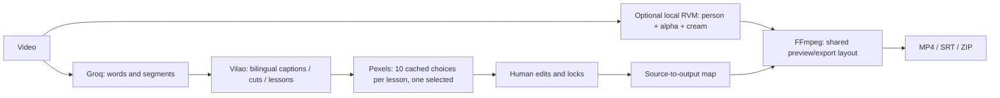

# System map — Vietnamese with Vinh / VietCut

This is the entry point for future agents. Read `AGENTS.md` as well. Update this map alongside architecture or behavior changes.

## Runtime and existing architecture

- Windows, Python 3.11+, React/TypeScript + Vite, FastAPI, SQLite, Pillow/OpenCV and FFmpeg with libass.
- `MO_VIETCUT.cmd` starts `start.py`; the browser opens on localhost using APP_PORT from `.env` (8876 on this installation).
- `backend/config.py`: workspace/data directories and server-only environment configuration.
- `backend/store.py`: SQLite projects/jobs, atomic JSON, per-project folders and revision persistence.
- `backend/app.py`: local HTTP API, upload/import/export, optimistic plan revisions, SSE and media Range responses.
- `backend/worker.py`: one durable background queue; resumes incomplete jobs at startup and supports cancellation. `backend/automation.py` watches one local folder, journals content identities separately from projects and submits sequential automatic pipeline/save jobs.
- `backend/providers.py`: Groq STT (300-second chunks), Vilao planning (120-second windows), Pexels search and asset download.
- `backend/timeline.py`: schemas, validation, cut merging and source/output time mapping.
- `backend/render.py`: legacy rendering, chunk caching, audio assembly and subtitles.
- `frontend/src.tsx`, `frontend/style.css`: local editor. `tests/`: offline behavioral and render tests. `scripts/`: opt-in live acceptance/diagnostic tools.

## Windows Start Menu launcher

- `TAO_BIEU_TUONG_START.cmd` invokes `scripts/install_start_shortcuts.py` using .venv Python when present, otherwise the installed Python. It creates **Vietnamese with Vinh.lnk** in the workspace root and personal Start Menu Programs via native WScript.Shell COM; `--verify` reads both links back without saving. Target is that environment's pythonw.exe, with the fully quoted absolute `launch_vietcut.pyw` argument, workspace WorkingDirectory and assets/vietcut.ico. Paths are passed as JSON through a child environment variable, never inserted into shell code. No execution-policy, registry pinning, admin rights or auto-login startup changes. User chooses Pin to Start through the normal Windows menu.
- `launch_vietcut.pyw` sets CWD from its own path, supplies UTF-8 stdout/stderr streams BEFORE loading Uvicorn and restores them on exit. pythonw otherwise has None streams, which can break Uvicorn logging. Startup/error output goes to ignored data/logs/launcher.log; startup failures show a generic Windows message with the log path, no key values.
- `start.py` is shared by the visible .cmd and hidden shortcut. Probe loopback health and require app= vietcut before opening the browser; no provider/network calls. A per-data-directory/port OS file lock serializes rapid launches and stays held for server lifetime. Another click waits for readiness and reopens the local browser instead of binding again. Validate APP_PORT, require the built frontend for cold start, listen only on 127.0.0.1. Closing the browser does not terminate background work.
- `assets/vietcut.ico` is a bundled multiresolution V/play icon generated by scripts/make_launcher_icon.py. Generated .lnk files contain machine-specific paths: ignore them and reject them in verify_staged.py. Commit the installer/icon/source, not installed shortcuts. Regenerate links after moving the workspace or changing Python.
- `tests/test_start.py` covers app identity, existing-server reuse, invalid port/missing build, rapid-click waiting, lock exclusion/release and loopback cold-start behavior. Actual Windows acceptance additionally creates/reads both shortcuts, cold-starts via the .lnk, confirms pythonw/no main window and checks a repeated hidden launch from another directory exits successfully. Evidence stays in OUTPUT/launcher/.

## Data flow



## Lesson-frame architecture (v1.1)

- `backend/lessons.py`: second AI pass for semantic learning targets, cross-window context, normalization/coverage, locked intervals and one Pexels image per target. `lesson_key` preserves Vietnamese diacritics. Never equate ma/má/mà.
- `backend/templates.py`: shared normalized geometry, brand/paper artwork, bundled Noto fonts, strict text fitting, face-aware speaker positioning. `assets/frame_brand.json` is the single brand/color source; `assets/fonts/` contains Noto Sans and Noto Serif with their OFL licenses.
- `backend/lesson_render.py`: static lesson pages + rounded speaker video + subtitle PNG overlays (portrait photo / landscape speaker, see v1.4). A lesson continues across 20-second render chunks and source cuts; image/text never pan or zoom. New pages fade only at real lesson transitions.
- `backend/render.py`: dispatches by `options.layout_mode`; retains the original renderer for legacy projects. Source audio, SRT timestamps and cuts share existing mapping helpers.
- `frontend/LessonEditor.tsx`: lesson list and fields. `frontend/src.tsx` owns split/merge/delete/boundary changes, photo selection, revision saving and explicit conversion. Editing a boundary updates its neighbor so coverage remains continuous.

### Contracts and compatibility

`Plan.schema_version=1` is the existing format. Version 2 adds `lessons` and requires complete, ordered, non-overlapping coverage from source second 0 through source duration.

```json
{
  "schema_version": 2,
  "summary": "Chào hỏi",
  "glossary": [], "cuts": [], "captions": [], "visuals": [],
  "lessons": [{
    "id": "lesson-0-0", "start": 0, "end": 60,
    "vi": "Xin chào", "en": "Hello", "chunks": [],
    "photo_query": "people greeting in Vietnam", "asset_id": null,
    "locked": false
  }]
}
```

`chunks` has at most three `{vi,en}` entries. `captions` remain independently timed spoken subtitles; lesson text is the teaching target, not all spoken instructions. The opening holds the first target and the ending holds the last. Adjacent occurrences of the same target are merged across AI windows. A non-adjacent recurrence can reuse its image. Locked lesson content AND exact intervals override AI proposals.

Options include `layout_mode` (`legacy`/`lesson`), nullable `speaker_x`/`speaker_y` in source fractions 0..1 and `speaker_scale` (0.65..1.5). The optional video_frames map is described in v1.5.2 below. Old/missing options decode to legacy. New project creation sets lesson mode unless the caller explicitly requests legacy. This distinction is intentional: do not change the global default and accidentally migrate existing ZIPs/projects.

### API and durable jobs

- `POST /api/projects` / `/api/projects/sample`: new lesson-mode projects, unless explicitly overridden.
- `PUT /api/projects/{id}/plan`: full plan + options + expected revision; validates coverage, assets and export-size text fitting before saving; optional render_preview defaults true, live UI passes false. Conflicts return 409.
- `POST /api/projects/{id}/reframe`: queues `reframe`; uses the saved transcript and existing captions/cuts, plans lessons and downloads illustrations. Saves old layout in history before committing the converted plan. If already converted, queues only preview so a failed render can be retried without additional AI calls. Existing projects never convert on read, startup or import.
- `POST /api/projects/{id}/revise`: generates an AI revision; both old caption/cut locks and new lesson locks are respected.
- Preview/export jobs use the same renderer/geometry. SSE, cancellation, versions, restore and ZIP import/export remain shared. ZIP includes source, transcript, assets, frame thumbnails and versions; generated lesson tiles are regenerated locally.

Pipeline order: frame extraction → cached/new STT → original bilingual-caption/cut analysis → semantic lesson pass (120-second windows with previous target) → per-target image selection → text preflight → revision save → preview. The temporary short visuals from the original pass are discarded in lesson mode. `reframe` skips the original caption/cut pass, preserving all manual edits, including unlocked caption edits.

### Geometry and rendering invariants

- Portrait reference: 1080×1920; photo top (46,96,988,566), target middle (46,692,988,484), speaker bottom (46,1208,988,570), preserving ~30% speaker height and bottom breathing room. Landscape keeps the left speaker/right teaching content geometry.
- Branding is small, exactly “Vietnamese with Vinh”. v1.4 uses flat beige #F7F3EB, white cards #FFFFFF, pastel #DCEAF4, navy #163247, secondary #456479, border #DCE4E8; no large colorful ornaments or blur. Theme lives in assets/frame_brand.json.
- Font sizes adapt without ellipsis. Text that cannot fit at the minimum legible size fails with a user-facing shorten/split message. Portrait subtitles overlay the lower photo region; landscape subtitles stay in the speaker region. subtitle_region/subtitle_position are shared by PNG preview/export. Face-aware crop and manual speaker controls remain shared.
- Lesson-frame images cover their illustration rectangle without blur or stretching. Overflow is cropped using the ratio-specific photo_crops. Speaker padding is flat brand cream, never a blurred duplicate. Missing images use a neutral teaching card and warning; legacy layouts retain their previous behavior.
- All source cuts remain inward-aligned to 30-fps boundaries. Intermediate chunks use PCM audio to avoid accumulating AAC delay. Final output is H.264 + AAC stereo.
- Lesson cache identity includes the render version, lesson-render version, template/font/brand content signature, chosen image bytes, speaker focus, plan, options and music. A change to rendering behavior MUST bump its version. A cosmetic template change must invalidate the template signature/version.
- On an identical-content cache hit, return the caller's current project revision in result metadata. Keep the immutable file/manifest content unchanged. Returning the original manifest revision falsely marks a correct reused preview as outdated after restoring/switching layouts.

## Pastel live editor and retention (v1.4)

- templates.py template v3 / lesson_render.py lesson renderer v5: portrait photo above, target in middle, speaker below (~30%); subtitle over the bottom of the TOP photo with translucent navy background. Landscape layout stays fixed and gets the same pastel theme. Inner boxes round to nearest pixel, without forcing even widths, so half-size preview keeps exact proportional placement; only H.264 canvas dimensions are even. Fonts are cached (128 entries); static page and subtitle functions can return Pillow images in memory for the live API without writing a file. Old exports/versions are not overwritten; legacy rendering still dispatches separately.
- `backend/live_preview.py`: read-only draft scene. `POST /api/projects/{id}/preview-scene` accepts sequence, a current draft lesson/caption and options, including temporarily empty text. Returns preview dimensions, geometry, identical speaker crop/pad transform, page/subtitle PNG data URLs, subtitle rectangle and unburned source selection/status. Assets must belong to the project. PNGs use the same Pillow functions/fonts as export; RAM LRU is bounded to 64 entries AND 24 MiB. No revisions, files, jobs, STT or providers are written/called while editing. Invalid/overflow text returns an error so the editor keeps its most recent valid frame and shows a warning.
- `frontend/LivePreview.tsx` composes the static PNG page, clipped source/composited speaker video and independent subtitle PNG. Uses SOURCE time, skips enabled source cuts, and updates captions/lessons at frame checks. Crop/position geometry is server authoritative, not a second text-layout implementation. Same-lesson caption edits do not change the photo/page cache. Normal edits coalesce for 100ms; a playback cue boundary requests immediately to reduce subtitle lag. `preview_requests.ts` cancels/disposes pending work and suppresses obsolete successes/errors even when an old request completes after abort. Built-in Node tests cover coalescing/out-of-order/unmount behavior without a browser dependency.
- Lesson editor Save sends `render_preview:false`. SavePlan and history RestoreBody default this optional flag to true for backward compatibility. Saving records history/revision but does not require an MP4 job; export remains explicit and uses saved data. The main preview switches between original source and live composition. Existing MP4s remain downloadable with their original revision metadata. Live audio uses source speech with optional measured, peak-limited browser gain (v1.5.1); final two-pass loudness normalization/music/SFX processing remains in export.
- Matting layer identity now excludes paper color. Completed v2 layer pairs may be adopted by comparing source bytes/model/config/size/fps/network/version, ignoring only paper. No original cache files are rewritten. New color-specific composition hashes include layer key + paper + composition version. Recolor uses committed foreground/gray alpha through FFmpeg, original audio, per-segment completion markers and a final manifest. Result exposes layer_code separately from color-specific code; comparison-frame API reads layer_code. GPU runtime is not initialized for a valid layer cache hit.
- `prepare_speaker` is a durable job to ensure/recolor the unburned source without generating a whole lesson MP4. Live source_info reports pending when matting/config/paper is stale or unavailable; it never presents an old composition as current. UI attempts preparation once per saved revision while idle/clean; failures have explicit retry and existing GPU/CPU/off controls, never silent CPU fallback.
- `backend/retention.py`: LIMIT30 / DAYS7, creation-date ordering (fallback updated_at for old missing dates), excludes diagnostics and queued/running/cancelling projects. Sweep after create/import, task completion, startup and hourly while app runs. If all candidates are busy, >30 is temporary. Import gets a new local created_at and preserves origin_created_at; imported retention/diagnostic flags are discarded. Recovered project is protected for that sweep and retains its original creation date.
- Retention JSON journal states active/archiving/trashed/restoring/purging under _retention. Move whole data/projects/<id> to data/trash/<id>; never touch files outside the project. Persist intent before moving/deleting; startup can complete interrupted operations. A Windows rename failure before movement rolls back to active so open files cannot hide an unmoved project. Purge only after a valid >=7-day deadline; no date means do not purge. Validate resolved root, IDs, direct and nested symlink/junction/reparse attributes BEFORE every recursive purge, then recheck target immediately before rmtree. Database/jobs are removed after filesystem deletion succeeds. Unsafe/locked paths stay with warnings for later diagnosis/retry.
- `store.read()` and `folder()` reject archived projects with TrashedProject (HTTP410), do not recreate their directories; job_create also rejects them. listing() omits trash by default; internal include_trashed exposes recovery records. SSE emits trashed and closes if a currently open project is moved. Frontend keeps its dirty draft, disables mutations and offers restore; after restore it reconnects and retains unsaved content. `GET /api/trash` and `POST /api/trash/{id}/restore` serve the 7-day Trash page. Restoration while full moves another oldest eligible project to trash.
- Verification: test_live_preview (read-only API/template equality/save without job/empty edits/latency), test_retention (29/30/31/busy/diagnostic/7 days/restore/crash states/rename failure/real Windows junction rejection in temp directories), matting palette reuse regression, node --test tests/preview_requests.test.mjs. scripts/acceptance_pastel.py clones a sample project, reuses old layers, measures warm API responses, exports both aspects, compares reconstructed live frames against export, and verifies original plan/options/assets/revisions. Tests that remove data MUST use a separate TemporaryDirectory, never actual user projects.

## Flat frames and ten-image sets (v1.3)

- `backend/templates.py` template v2 / `backend/lesson_render.py` lesson renderer v4 remove blurred speaker extensions and contain-over-blur photos. Speaker focus/scale, thin rounded border, subtitle clearance and region geometry are unchanged. Pad the original/composited speaker once onto solid brand cream. This does not change the matting processor or its cache digest.
- `backend/photo_layout.py` is the authoritative cover geometry. Scale uniformly to fill, multiply zoom 1..3, round scaled dimensions upward, then crop the overflow at normalized x/y 0..1 (default .5). Both `make_frame` and the editor's GET photo-layout use it; no blur, letterbox or distortion. Template, tile and chunk identities include crop state and bumped versions.
- Optional Lesson fields: `photo_candidates` (0..10 distinct asset IDs) and `photo_crops` (`9:16` / `16:9` → finite x,y in 0..1, zoom in 1..3). Missing fields default empty, preserving v2 compatibility. Original aspect uses the portrait/landscape crop key according to source dimensions. Frontend selection of a different image clears both crops; each ratio otherwise keeps its own crop. Save/restore/import validate referenced candidate assets; snapshots and ZIP retain the fields and all local image assets.
- `backend/photo_pools.py`: per semantic vi/en/query key, search up to two pages of 30 Pexels candidates, remove duplicate IDs, rank with Vilao (first ten thumbnails when vision is available, metadata for remaining candidates), then download ten successful distinct choices. Default is the first ranked downloaded image; never overwrite an existing selected/locked image merely to prepare or refresh a set. Repeated same targets reuse the set without another provider call. New/revised lesson pipelines prepare sets; opening existing projects never does so.
- Resumable manifests live in analysis/photo-pools/<target>/<generation>/pool.json; atomically persist ranking and every downloaded asset. Cancellation preserves committed downloads. A refresh has a new generation, excludes the currently shown set/selection, preserves the selected image and can retry the same generation. Failed downloads try remaining ranked candidates; an insufficient set reports its actual count. Empty/error results keep the previous pool and selected image. Provider failures remain sanitized. Downloaded JPG files are committed via temporary files and decoded/EXIF-normalized before use.
- `POST /api/projects/{id}/lessons/{lesson_id}/photo-candidates` takes `{revision,refresh:false}` and queues durable `lesson_photos`; stale revisions return 409. `POST /api/jobs/{job_id}/retry` retries only failed/cancelled photo jobs with the same request/generation. The worker versions a changed plan, saves assets/set and regenerates preview from existing matting; rendering does not redo STT or lesson analysis. `GET /api/projects/{id}/photo-layout?asset_id=&ratio=&zoom=` returns frame/scaled sizes and overflow from shared geometry; it never contacts providers.
- `frontend/PhotoCrop.tsx` displays those exact proportions for drag, position sliders, zoom and reset. `LessonEditor.tsx` shows local thumbnails, count, selected state, prepare/supplement/refresh actions and existing search/upload. Save is required before starting a set task and after changing selection/crop. Local choice requires no network beyond localhost. Cancelling a photo task exposes retry.
- Pexels manual search now returns ten results; legacy automated asset selection keeps its six-result default. The API key stays server-side. Photographer names and existing Pexels links remain visible; export credits list only actually selected assets. Provider endpoint parameters follow https://www.pexels.com/api/documentation/ .
- `tests/test_photo_pools.py`: source aspect/cover/zoom, crop rendering, old defaults, bounds, AI ID filtering, duplicate/partial sets, network errors, cancel/resume, refresh exclusion, recurrence with locked selections, offline choice, API revision checks, ZIP/history round trips. Speaker flat padding is a real FFmpeg render regression in test_lesson_render. `scripts/acceptance_photo_frames.py` is opt-in live Pexels/Vilao acceptance on a separate clone, reusing committed matting and checking both full exports, actual ten JPGs, refresh, source-project preservation and ZIP image hashes. It does not run Groq again.

## Background removal (v1.2)

- `backend/matting_schema.py`: portable `options.background_removal={enabled,device,soften,contract,strokes}`. Each stroke has id, source start/end, keep/remove, normalized radius and normalized points. Finite/bounded validation and duration checks apply on create/save/restore/import. Missing config decodes OFF; only NEW creation defaults ON. Reading old projects does not mutate them.
- `backend/matting.py`: orchestration, source/model SHA-256 verification, cache identity, runtime readiness, cancellable subprocess, source-time composition and original-audio mux. Torch/CUDA are NEVER imported into the app process. GPU unavailable is an explicit error with CPU/off choices, never implicit CPU fallback.
- `scripts/matting_runner.py`: bounded 1MB Windows pipes (not whole-video buffers), single filter threads, optional NVENC encoding to reduce CPU load; isolated Python process, official RVM MobileNetV3 v1.0.0 TorchScript, FP16 CUDA / explicit FP32 CPU. First frame uses 4D to initialize state (official v1 script cannot initialize from a 5D batch); subsequent batches are four sequential frames. GPU OOM retries one at a time without discarding recurrent state. Working long side <=1920, internal <=512, CFR30.
- Each source-time 600-frame segment commits only after foreground H.264 yuv444p QP16 NVENC (CRF16 CPU encoding fallback), lossless gray FFV1 alpha, cream H.264 composition, four recurrent tensors in safe NPZ, tracking state and completion JSON are successfully written. Resume restores the contiguous prefix and model state; it does not reset every 20 seconds. Unfinished segments are overwritten. Source timestamps remain authoritative; render cuts are applied AFTER matting.
- Keep/remove strokes propagate FORWARD using pyramidal optical flow at <=640px. Forward/backward error, tracking status, bounds and scene histogram checks gate confidence. An unreliable stroke stops until another user mark, with source-time warning. Correction state and previous grayscale image are checkpointed across segments. Held objects are outside the intended preservation requirement.
- `backend/worker.py:prepared_render`: matting before rendering, persists result metadata, passes ephemeral render_source_file to either renderer. Stored source_file and source recording stay intact. Audio is muxed from original source before existing cuts/audio processing. Lesson/photo/subtitle logic stays shared. Matting code is part of lesson render/chunk identity; explicit matting code in both manifest/chunk identities handles legacy rendering too.
- `frontend/MattingPanel.tsx`: explicit enable/device, status, edge controls, before/after video, source-frame keep/remove canvas, correction end time, remove-stroke, black/white/cream checks and speed/warning readout. Global save/revision/history machinery persists options. Current source-time mapping drives marking even when viewing a cut preview.
- `GET /api/matting/status`: isolated runtime/GPU and verified model readiness. `GET /api/projects/{id}/matting/frame?time=&before=&background=`: bounded source-time PNG from original or committed paired layers; never initiates inference. Dirty controls require Save before the after image changes. Paired layers are trimmed by exact frame index within the committed segment: timestamp seeking across H.264/FFV1 time bases can silently produce a blank overlay near segment ends.
- Cache path `data/projects/<id>/matting/<sha>/`; digest includes source bytes, pinned model bytes, processor version, working size, edges and strokes. Layer identity excludes paper; a separate composition digest includes paper (v1.4). It excludes ratio/lessons/photos/subtitles/cuts: all use the same person/alpha layers. Edge/brush changes currently recompute inference for their distinct digest (no independent raw-layer reuse yet).
- `scripts/setup_matting.py` / `CAI_DAT_XOA_PHONG.cmd`: isolated `data/runtime/matting`, torch2.8.0 cu128 + numpy2.2.6/OpenCV4.12; official models pinned by SHA-256 under `data/runtime/models`. Does not alter global CPU Torch. GPL source/license/attribution in assets/licenses; see HUONG_DAN_GPU.md. Runtime/models/masks never belong in Git or ZIP. ZIP exports only configuration/strokes; import drops generated matting metadata and regenerates.
- `tests/test_matting.py`: default/compatibility, time/brush bounds, cache invalidation/reuse, no silent CPU fallback, checksum rejection, optical-flow confidence, tracking checkpoint continuity, full-frame pipe transfer, simulated OOM recurrence, exact-frame boundary previews, ZIP config round trip. `scripts/acceptance_matting.py` opt-in actual GPU test creates a separate clone of an existing lesson project without provider calls; checks cancellation/resume, both aspect exports, full FFmpeg decode, source/project preservation and three-background snapshots. Quality approval remains pending user review.

## Where to change a feature

| Need | Primary locations | Verification |
| --- | --- | --- |
| Branding, colors, region positions, fonts | frame_brand.json, templates.py | both ratios, Vietnamese text, long sentences |
| AI grouping or keeping an image across practice | lessons.py | boundary 120s, repeat targets, exact locked regions |
| Speaker crop, subtitles, transition or video output | lesson_render.py, templates.py | speaker containment, decode, boundary 20s, cache invalidation |
| Lesson editing / photo UI | LessonEditor.tsx, src.tsx | add/split/merge/delete, neighbor boundaries, save conflict |
| Plan data or conversion | timeline.py, app.py, worker.py | v1 compatibility, v2 ZIP, conversion history, rollback |
| Provider errors or media retrieval | providers.py | retries, missing-image fallback, no credentials in responses |

## Storage and recovery

`data/studio.sqlite` stores project JSON and jobs. Each `data/projects/<id>/` contains the copied source, transcript/audio caches, analysis caches, assets, frame samples, version snapshots, immutable renders, render-cache chunks and generated `lesson-tiles`. SQLite is authoritative for the current plan/options. Completed cache markers are written only after FFmpeg succeeds. Never reuse partial chunks without their completion marker. Cancelled work keeps completed stages; startup requeues interrupted running jobs.

The checked-in tests are offline and never bill APIs. `scripts/acceptance_lessons.py` is an opt-in live sample acceptance; it creates a separate project, exports both ratios, round-trips v2 ZIP, converts a disposable imported v1 copy and verifies the original projects are byte-for-byte unchanged. Scripts for earlier delivery are installation-specific diagnostics, not startup dependencies.

## Operational rules

Keep source audio/video on disk intact. Work against a separate demo project when validating new rendering. Do not convert the two existing user projects automatically.

Use `python -X utf8 -m unittest discover -s tests -v` and `npm run build`. Live provider tests require the user's `.env` and use API quota. The 60-minute test is simulated; do not claim a full-hour Full HD benchmark unless one was actually run.

Only code, blank configuration, documentation, licensed template/font assets and tests belong on GitHub. `.env`, data, OUTPUT, original recordings and caches stay local. Run `python scripts/verify_staged.py` after staging; it scans Git index paths and bytes, without printing key values. Commit and push completed tested changes to main, then compare local HEAD to `git ls-remote origin refs/heads/main`. Never force-push. If blocked by auth/network, keep the local commit and report incomplete synchronization.

## Troubleshooting

- No lessons tab on an old project: expected; use its explicit conversion button.
- Image disappears mid-lesson: inspect semantic coverage and `mapped_lessons`; do not tie content lifetime to subtitle cues or chunk boundaries.
- Missing face/head/mouth: inspect sampled face boxes, speaker focus and manual x/y/scale controls; preserve subtitle clearance.
- Text overflow: shorten/split the lesson or remove overlong explanatory chunks. Never restore silent truncation.
- Old visual appears after changing theme/asset: inspect template/file content hashes and render-version invalidation.
- API error: inspect job's sanitized error; check .env using the settings UI. Never paste credentials into logs or reports.
- Current limits: source up to 60 minutes; full-hour orchestration has simulated coverage, not a measured one-hour Full HD performance guarantee.

## SEO downloads

- backend/seo.py supplies Unicode lesson-based MP4 names and safe ASCII names for language-specific SRT and ZIP (v1.5 naming below). Newly rendered MP4s embed lesson title, description, keywords in comment, author, education genre and Vietnamese language. Renderer v8 invalidates old output caches; title participates in output identity. Existing saved exports remain intact. Download controls appear above the editor grid.
- Validation: npm run build and offline unittest suite (see delivery result).

## Landscape thumbnails
- backend/thumbnail.py renders one fixed 1280x720 frame: thick pastel-blue outer border, white background, rounded pastel text card left, illustration right, fixed Vietnamese with Vinh branding. English is primary, Vietnamese secondary. Fonts/colors share templates.brand/font; text fits without truncation or returns an actionable 422.
- GET /api/projects/{id}/thumbnail remains a read-only download, defaulting to the first saved lesson. POST on the same path accepts lesson_id, en, vi, asset_id, crop {x,y,zoom}; validates lesson membership, project-owned asset, resolved assets-directory containment and shared PhotoCrop bounds. Returns identical PNG bytes for preview/download, no-store; no providers, jobs, project/version/cache writes. Routes MUST precede the frontend root static mount.
- frontend/ThumbnailEditor.tsx opens from the fully labeled export button next to video export. Responsive actions wrap instead of hiding labels/buttons. Defaults to the selected saved lesson or first; supports lesson/asset choice, separate bilingual text and horizontal/vertical/zoom crop sliders. Changes are modal-local and discarded on close. Preview requests debounce 200ms, abort obsolete requests and revoke blob URLs; download uses exactly the displayed PNG. Missing lessons/unsaved video edits have visible guidance; missing assets/overflow show actionable errors. No conversion or existing video/export changes.
- Validation: npm run build passed; tests/test_thumbnail.py (4 tests) passed with disposable temporary projects, covering actual GET/POST routing, PNG identity/dimensions, Vietnamese, both image aspects/crop, missing lessons/assets/files, path escape, overflow, crop bounds and no project/job mutation. Synthetic PNG visually inspected; no real project used for destructive testing. CTR is a design goal, never guaranteed.
- Regression validation: test_live_preview.py 8/8 and preview_requests.test.mjs 3/3 passed.

- Runtime update note: rebuilding frontend does not reload the running Python server; even reopening the launcher reuses it. Thumbnail 404/405 now explains that VietCut needs restarting and the page reloading. Verify running /openapi.json exposes thumbnail GET and POST after restart.
- Runtime mismatch fix validation: thumbnail tests 4/4 and npm run build passed. Confirmed old live server had no thumbnail route and no active jobs; restarted verified workspace launcher and checked live API methods.


## Folder automation, lesson naming and matting acceleration (v1.5)

- `backend/automation.py` owns one persisted selected root plus enable/pause state. A daemon scanner starts/stops with FastAPI lifespan. Walk every 5 seconds recursively, reject symlinks/junctions and exclude internal DATA_DIR. File size/mtime must remain unchanged for at least 10 seconds; hash with SHA-256, recheck stat, copy into project and verify both copied hash and original stat/hash before queueing. Explicit Scan also grants a 15-second background stability window while paused; it does not enable dispatch. One existing worker processes jobs; automatic dispatch waits for all active jobs and submits only one automatic source at a time. Pausing leaves the current job running and stops dispatch.
- SQLite adds `automation_settings`, `automation_items` (content-hash primary key with durable source/project/job/output/error/retry state), and `automation_outputs` (hash/path registry). They have no cascading foreign keys to projects: retention never deletes completion history. Existing owned sources/exports are indexed once per source signature/export digest, including Trash; only successful saved exports are marked done. Backfill never changes existing project JSON. Eligible incomplete lesson projects with matching automatic ratio, bilingual captions and matching configured background-removal settings can resume; legacy projects never convert automatically. Hashes are reused only while their file signatures still match.
- Automatic new projects choose 9:16/1080x1920 when SOURCE/container duration <=90 seconds, otherwise 16:9/1920x1080; layout lesson, bilingual subtitles and original video background by default (v1.5.2); removal is an explicit CUDA option. Pipeline request carries private `automation_hash`; worker skips the preview MP4, renders full export then publishes. Internal `auto_save` job retries publication of an existing export without STT, providers, matting or rendering. `worker.Context.kind` remains export-compatible for progress/rendering.
- Publish fully decodes with FFmpeg xerror, checks duration, stages a `.partial` file beside source, fsyncs and verifies bytes, then performs a no-overwrite rename/link. Journal the intended output path before publishing so an interrupted final save can recognize identical existing bytes. Unicode lesson filename collisions receive ` (2)`, ` (3)`, etc. Register outputs by bytes, including manual export results, and recheck before dispatch so a completed MP4 cannot become another source. A source is done only after its adjacent file is committed. Temporary I/O/network/provider 408/429/5xx failures retry after 30 and 120 seconds, then fail and allow the next source; configuration/GPU issues need attention and explicit retry. Pending automatic save/retry ownership is retention-busy until done/failed/cancelled.
- APIs before static mount: GET/PUT `/api/automation` for public folder/enabled/message/remove_background (missing means false), counts and recent 300 items; POST `/api/automation/folder` opens a separate hidden-console Tk folder picker; POST `/api/automation/scan`; POST `/api/automation/items/{hash}/retry`. Folder path input remains available if the picker is unavailable. Runtime stays loopback-only with existing Host/Origin protection; no OS auto-start or paid matting service is introduced.
- `frontend/AutomationPanel.tsx` polls every 2 seconds and exposes folder selection, enable/pause, scan, per-source progress/status, duplicate reports, outputs and retry. The editor's failed automated jobs retry through the automation ledger rather than dropping the automation request. Source drafts remain intact when visiting the panel; SSE refreshes no longer navigate away from settings/automation. Compact sidebar keeps all navigation icons reachable.
- Only new creation stores `title_mode=auto/manual`; omitted/generic names mean auto. After saved semantic analysis, one target uses its Vietnamese text; several use the existing AI topic summary. Explicit PATCH `/api/projects/{id}/title` switches to manual and never gets overwritten on retry. Existing projects without the field keep their titles. New MP4 downloads/publications use `<lesson> - learn vietnamese.mp4`, NFC Vietnamese, safe Windows characters/device names; ZIP/SRT retain portable ASCII names. Renderer version 9 and both output identities use the effective SEO title so switching title ownership cannot reuse stale MP4 metadata. Existing renders remain immutable.
- Matting processor version 3 separates video-stream end from project/container duration. Decode with xerror, fps=30:start_time=0 and trim by the absolute source frame AFTER normalization (no input seek reset on resume). At clean EOF, check decoder exit/error stream and declared video end, tolerate at most the CFR rounding frame, and pad only the verified audio/container tail. Partial raw frames and abnormal early EOF fail. Validate final decoder success BEFORE the final segment completion record. For formats with unknown stream end, only the two-frame rounding allowance is permitted; unexplained long missing tails are rejected.
- Two-frame decode read-ahead plus two-frame queues per encoder bound RAM and overlap I/O. Mandatory segment commits retain four recurrent tensors, tracking grayscale/corrections, foreground, lossless alpha and composition; OOM retains recurrence and reduces batch size as before. Advisory progress writes at most twice/second; Windows sharing failures cannot abort work for progress alone. Checkpoint atomic replacements retry transient sharing violations. Background subprocess errors use UTF-8 and a concise last error in UI, with private failure detail on disk.
- CUDA without brush strokes downloads alpha for existing OpenCV edge correction while RGB stays on GPU; compose/quantize in FP32 then transfer uint8. Brush corrections and explicit CPU retain their full processing path. Same model, all 30-fps frames and existing working size, no silent CPU fallback. Segment completion records add `paper`/`composition_version`; matching committed compositions go straight to concat/mux instead of being re-encoded from alpha. Palette changes still reuse raw layers and recolor through FFmpeg. v2 caches remain on disk but are not adopted across processor version changes.
- `stats.timings` separates read/decode wait, upload, download, corrections, composition/packing, concurrent encoder writes and encoder finalization; overlapping sums are not wall time. `scripts/benchmark_matting_speed.py` uses fresh private copies and a supplied old runner; `scripts/acceptance_matting_recovery.py` performs real checkpoint cancellation/resume and full decode without project or provider writes. Artifacts stay in ignored OUTPUT. Frame extraction now explicitly requests yuvj420p for JPEG, fixing FFmpeg rejecting limited-range MJPEG during new-source ingestion.
- Measured 2026-11-04 on RTX3060 Laptop 6GB: identical 20.011-second source, CUDA FP16/NVENC, cold end-to-end 127.969s -> 61.668s (51.81% less), warm cache 0.022s. Alpha at 0.2/5/19.9s identical byte-for-byte, black/white/cream snapshots visually reviewed; no claim of CapCut parity. Read-only original failure probe: video 63.281733s, container 63.301417s; copied source completed 1900 frames, cancelled/resumed from 600 with checkpoint hashes unchanged, full output decode 63.333333s, original bytes preserved.
- Validation: offline suite, real synthetic folder-to-Full-HD MP4 ingestion/export/publication/no-loop test, Node preview tests and npm build (final counts recorded with delivery). Tests use TemporaryDirectory and mocked provider responses, never real projects for destructive testing. API tests need functioning Windows loopback/socketpair. Actual acceptance uses only separate copies and no provider quota.

- Final v1.5 validation: 97 offline Python tests passed, 3 Node preview tests passed, npm run build passed. Actual saved-lesson clone exported portrait 1080x1920 for the full 63.301417-second lesson and passed full FFmpeg decode; original source/project retained. Browser QA verified compact navigation plus enable/pause on an empty private test root. Private measurement/recovery/export artifacts remain in OUTPUT only.


## Automatic voice volume (v1.5.1)

- `options.auto_volume: bool=true` enables automatic voice balancing on new manual/automatic projects and future renders of old projects with the field missing. An explicit false is persisted by normal save/history/ZIP options. Existing recordings, layouts, titles, saved versions and MP4s remain intact; rerender/export is required to change an existing MP4. Completed folder sources are not automatically reprocessed merely for this update.
- `backend/audio.py` is the shared processing contract. Export measures the concatenated PCM audio AFTER shared cuts, BEFORE music/effects, then applies measured two-pass FFmpeg loudnorm targeting -16 LUFS, -1.5 dBTP, LRA 11. Linear mode is used when possible; FFmpeg's dynamic mode handles larger loudness range/peak constraints. Both lesson and legacy renderers use the same measured voice chain followed by existing music ducking/SFX and final limiter. Stereo mapping and 48kHz sampling are explicit. This is a level adjustment, not source separation or noise removal.
- Silence/non-finite integrated measurements do not receive unbounded amplification. Very short audible clips use original volumedetect mean/peak as a finite fallback; preview/fallback gain is bounded -60..+48dB and constrained by peak headroom. Analysis is cancellable with a bounded temporary stderr file, no full audio RAM buffers, no providers and no Torch changes. The numeric first-pass summary is saved as voice-level.json inside the immutable render directory, with audio metadata in the final manifest.
- `AUDIO_VERSION=1` participates in BOTH final output identities, invalidating old one-pass MP4 results. It deliberately does not invalidate visual chunks or matting. Legacy chunk identity excludes the audio-only auto_volume option, so toggling volume reuses identical picture/PCM chunks. Lesson chunk identity was already independent of this option. Existing files/manifests are never overwritten.
- GET `/api/projects/{id}/audio-level` measures only the owned ORIGINAL source for live monitoring. It returns finite gain/silence/loudness/peak fields, rejects Trash through normal access checks and never writes project JSON, revisions, jobs or files. A 64-entry in-memory LRU keyed by resolved path/size/mtime/audio version avoids duplicate source decoding. Source speech is measured as stereo; live gain is peak-limited and may be more conservative than the final dynamic normalization.
- `frontend/audio_volume.ts` maintains one MediaElementAudioSource/Gain graph per actual video DOM element. Initialize only on playback, resume under the playback gesture, smooth gain changes, retain binding across option/source changes and Strict Mode cleanup, close on real unmount. Never apply it to already-rendered MP4 playback or to Bản gốc. `LivePreview.tsx` requests source gain once per source/option change, aborts obsolete responses, applies gain to the unburned speaker video and shows measurement/ready/error status. Option off returns unity gain without double processing. The CÁCH DỰNG checkbox defaults on; automatic folder UI confirms voice balancing.
- Validation: 103 offline Python tests passed (including quiet/loud/silent/short audio, cancellation, read-only/cached preview API, Trash rejection, both real renderer outputs after cuts, unchanged source and reused visual chunks); 6 Node tests passed (single graph/enable-disable/release/finite gain plus preview request races); npm run build passed. Browser QA on a separate synthetic project verified measured status, playback without console errors, off -> original level and on -> measured gain without another media binding.
- Read-only real-source-copy acceptance: source loudness -25.86 LUFS -> newly encoded AAC -16.07 LUFS (about 9.79 LU louder), measured output true peak -1.34 dBTP after AAC, source hash unchanged. Private report/audio stay under OUTPUT/audio-validation; no real project modified for testing. Live monitoring used +5.3dB peak-limited gain on this source; export uses full measured normalization. Targets are processing targets, not guarantees for every noise floor/codec/source.


## Original background, video framing and manual cuts (v1.5.2)

- New manual/API/sample/automatic lesson projects keep the ORIGINAL background by default. The UI checkbox **Không xoá nền video** is the inverse of persisted `options.background_removal.enabled`. New-project modal, editor matting panel and folder automation expose it. Existing saved options are never migrated. Automation persists `remove_background` in its configuration; missing means false, changing it affects only subsequent new projects. Existing owned work resumes with its saved settings; matching unowned incomplete projects must match the selected background mode. No matting model/runtime/cache change; no GPU-to-CPU fallback.
- `options.video_frames` maps `9:16` / `16:9` to `{zoom:0.25..4,x:-1..1,y:-1..1}`, finite values only. New lesson projects initialize both at `{zoom:1,x:0,y:0}`: contain the entire original video centered inside the existing speaker region. Zoom is uniform, x/y are offsets in speaker-region widths/heights. Clip overflow, pad uncovered areas with flat brand cream, retain rounded bounds. Controls affect the entire video, not individual lessons. Original aspect selects the map entry from actual output orientation. Save/history/restore/ZIP retain both entries.
- Missing map entries preserve the existing face-aware speaker_x/y/scale layout until the user edits framing. `templates.speaker_transform` is the authoritative integer rectangle; `speaker_filter` derives identical FFmpeg crop/pad from it. `LivePreview` clips that rectangle, supports pointer dragging, zoom/position sliders and reset to contain/center. Options and transform participate in output/chunk identity. TEMPLATE_VERSION=4 and LESSON_RENDER_VERSION=6 invalidate older generated composition without changing saved exports or matting caches. Legacy rendering remains separate and requires explicit conversion for lesson-frame controls.
- `frontend/CutTimeline.tsx` replaces the fixed source timeline with a horizontally scrollable 1..256x timeline. Retains selectable caption/illustration/lesson tracks. Dynamic ruler, source-time playhead, pointer scrubbing, single-frame buttons, keyboard Left/Right (Shift = one second), fit-all, editable start/end marks and **Cắt bỏ đoạn**. Zoom centers the playhead. Clicking/scrubbing opens original-source playback so removed spans remain inspectable. Live composition skips enabled cuts only while playing, allowing exact paused inspection. Existing cuts can be disabled to restore the span; manual cuts default locked. No source media or lesson/caption timestamps are rewritten.
- `frontend/editing.ts` aligns selections inward to 30fps, rejects reversed/out-of-range/non-finite/subframe cuts and considers the union with enabled existing cuts before preserving at least min(0.5,duration) seconds. The server remains authoritative via `validate_plan` / shared `keep_spans` / mapping helpers. Save uses the existing plan endpoint/revisions; export consumes the saved plan, never reruns transcription/AI for manual edits.
- After a manual export of an automatically owned project, `worker` calls `automation.publish_edited`. It uses the recorded external original-source directory and the existing validated, hashed, no-overwrite publisher; collisions get numbered names. A separate atomic per-render journal in `analysis/manual-publications/<digest>.json` resumes publication without changing the completed automation ledger or restarting ingestion. Backfilled manual projects with internal source paths stay download-only. Old source and previous MP4 bytes remain intact; output hashes prevent re-ingestion. Successful export metadata exposes `published_file` for the editor to display the actual saved path. A failed copy leaves the render downloadable and normal export retry reuses the render cache.
- Validation 2026-11-11: 9 Node tests passed; npm build passed. Full Python discovery through a test-only polling event loop (in-memory ASGI avoids Windows sandbox-blocked loopback self-pipes) ran 111 tests: 109 passed, two existing retention junction tests were blocked by Windows symlink/junction privileges. No retention code was changed. Targeted verification includes default/explicit removal, old options and per-ratio persistence/restore, exact FFmpeg-vs-browser geometry at zoom/drag extremes, manual publication collisions/retry/source preservation, no AI on manual export, and a synthetic automatic Full-HD export followed by manual cut/reframe/export/full decode with no output re-ingestion. Final targeted verification: 47/47 Python tests passed (including the additional new-background configuration regression), 9/9 Node tests passed, npm run build passed. Browser QA could not reach the isolated localhost test server due network restrictions; no interactive visual acceptance is claimed. Private test-only runner/logs/synthetic media stay in ignored OUTPUT/edit-validation; no real project used for destructive tests.

- Delivery synchronization: staging was blocked because this session has read-only access to the workspace .git directory (git add cannot create index.lock). Changes remain in the working tree; no commit/push was possible. The index scanner saw zero staged paths. Changed working-tree code/docs/tests were separately scanned for configured credentials and private/generated paths before handoff.


## Provider disconnect recovery (v1.5.3)

- `providers.request` now treats HTTPX RemoteProtocolError and ProxyError as transient alongside timeout/network exceptions. Retry at most three attempts, with cancellable 0.2-second backoff checks; do not retry authentication errors or LocalProtocolError. Report provider + next attempt through Context.progress without decreasing the saved percentage. Exhausted transport errors become a sanitized ProviderError with no raw endpoint/response/credentials; the existing automatic queue classifies it as retry_wait and applies its 30/120-second schedule.
- `tests/test_provider_retries.py` covers disconnect recovery, bounded retries for timeout/connect/proxy/protocol failures, automatic retry classification, HTTP401/no response leakage, non-retryable invalid local requests, cancellation during backoff, HTTP429/503 recovery, and STT response-cache reuse/source preservation after interruption. Focused provider/AI/automation run: 25 tests passed; 9 Node tests and npm build passed. Broader discovery encountered the existing Windows junction privilege restrictions; do not claim unqualified full-suite acceptance.
- User authorized changing CURRENT automation settings plus the three unfinished 2026-11-11 projects to original background, overriding earlier preserve-existing-settings behavior for these projects only. Cancel the old in-progress export through normal job cancellation; save background_removal.enabled=false with version history for the already planned project. Persist remove_background=false for automation. Resume the existing projects with their own automation ownership, original source timestamps and committed transcript/plan/image caches. No source, previous render, model/mask or old version is deleted.
- Runtime deployment requires restarting the Python server, not merely closing the browser. During this session Task Manager access was denied by automatic review, and the original server remained active; code changes on disk must not be reported as loaded by that process. Runtime recovery/export results will be recorded after actual completion. Private operational monitoring is under ignored OUTPUT/provider-recovery.

- Runtime mismatch guard: health version now comes from app.version (the former hardcoded 1.5.1 was stale), plus provider_retry_version=1. Frontend 1.5.3 performs one read-only startup check and explains restarting the Python server if the loaded version/feature marker differs. This does not interrupt jobs or mutate projects; ApiTests verifies the loaded marker.


## Media stall watchdog and safe restart (v1.5.3)

- `media.ffmpeg` is non-interactive (`-nostdin`, stdin DEVNULL) and emits structured progress to a drained stdout pipe. `media.run` tracks advancing frame/output-time counters using monotonic time; repeated unchanged progress is not a heartbeat. After 180 seconds without advancement it terminates/waits/kills only its OWN child and raises MediaStalled (TimeoutError), allowing existing 30/120-second automation retry. Cancellation still terminates the owned child. Stderr stays on disk and error excerpts bounded; stdout lines are bounded to 4096 bytes. No picture/audio/filter/model or matting cache identity changes. Completed chunk markers remain authoritative; a failed partial never gets a completion marker.
- `tests/test_media_progress.py` exercises real isolated subprocesses: stationary repeated progress, a process progressing longer than the threshold, cancellation, diagnostic preservation, child cleanup and automatic transient classification. Media/lesson-render/provider/API focused run: 17 tests passed. No real project used for destructive tests.
- `KHOI_DONG_LAI_VIETCUT.cmd` / `scripts/restart_vietcut.py` are USER-INVOKED restart helpers. Refuse while jobs are running/cancelling, validate port, inspect port owners without printing command lines or credentials, and accept only Python processes with this workspace's fully-qualified launch_vietcut.pyw/start.py argument. Refuse relative/unknown/other-workspace owners. Recheck jobs before stopping; open the exact PID handle and compare kernel creation time with inspected creation time to reject PID reuse. Stop only the verified idle server; never other Python processes or the computer. Start the existing hidden launcher and require health version 1.5.3 + provider_retry_version=1. No admin, security/registry/execution-policy change, or blanket taskkill. Six mocked restart ownership/idle/race/loaded-version tests passed; a matching path merely passed to another script or Python -c is rejected. Actual host restart remains a user action when session process/loopback permissions prevent controlling the running server.
- 2026-11-12 operational recovery: the original 1.5.1 service remained unresponsive at a render chunk after the prior session ended. Automation dispatch was paused with remove_background=false; stale jobs for the THREE explicitly authorized projects were cancelled, preserving versions and all source/cache bytes. A bounded local recovery controller renders already-planned projects serially with the updated renderer and no providers/matting; each Full-HD MP4 is fully decoded and checked against source hashes, saved cuts, revision and original-background options before publishing export metadata. Publication is separately queued as existing auto_save jobs; the third source remains a normal pipeline job because STT is missing and this sandbox cannot connect to Groq. No external-folder writes are attempted by the restricted recovery process. Private controller/audits remain in OUTPUT/provider-recovery. Final export counts and activation status must be reported from actual completion, not from queued jobs.

- Final focused verification after watchdog/restart hardening: 10/10 restart + real media-progress tests passed; preceding media/lesson-render/provider/API run passed 17/17; frontend build 1.5.3 passed. Working-tree credential scan covered all 31 changed/untracked source/document/test files with no configured-secret or token-pattern matches; staged paths remain zero because .git is read-only. Mocked restart output does not establish live server activation.

- Verified recovery outcome 2026-11-12: TWO existing projects now have completed 1920x1080 MP4 exports (209.542s and 211.301s). Each passed full FFmpeg decode, expected cut duration, unchanged original-source hash and background_removal=false checks. They are saved as project exports and have normal auto_save publication jobs queued. The 205.253s project has no transcript and remains queued as pipeline; no third-video completion or external-folder publication is claimed. Original server activation is still blocked in this session; the user must invoke the prepared restart helper before those queued tasks can continue on 1.5.3.

## Assembly editor and circular landscape speaker (2026-11-12)

- `frontend/EditorWorkspace.tsx` owns the responsive three-column workspace: lesson/caption list left, preview center, selected-item properties right. `LessonEditor` and caption/cut properties use React portals into the properties host. On narrow screens panels stack. `frontend/useCutHistory.ts` maintains up to 100 session cut undo/redo steps, resetting on project change; saved revision history remains independent.
- `frontend/output_timeline.ts` mirrors backend `keep_spans` / interval mapping. `CutTimeline` now displays only the retained ASSEMBLY and its duration, mapping selection/seeking/caption/lesson tracks back to authoritative source seconds. Temporary split markers divide selectable clips; deleting a selection creates a locked source cut and ripple-joins the remainder. Source order never changes. Split markers are editing aids, not new persisted media segments. Drag selection handles, mark-in/out, frame stepping, horizontal zoom 1..256, thumbnails, waveform, cut restore, undo/redo and vertical timeline resizing are available. Restore list explicitly uses original-source times. Live preview's scrubber also uses assembly time. Manual export does not invoke STT/AI.
- `backend/edit_media.py` provides read-only GET `/api/projects/{id}/waveform`: original-source mono 8kHz PCM in a temporary directory, reduced to at most 1600 peak samples, bounded 16-entry stat-keyed RAM cache. Uses closed file reads rather than memmap to avoid Windows sharing locks. No project/revision/job/provider/matting writes; the existing media watchdog bounds FFmpeg stalls. Frontend maps peak samples through current draft cuts and reuses owned frame thumbnails.
- Options add `landscape_layout: classic|circle` (missing = classic for saved projects) and finite `speaker_size: .15.. .4` (default .25 of output height). New lesson projects default to circle unless explicitly overridden. New manual wizard starts at 16:9; folder automation retains its duration-based ratio choice. Portrait and legacy geometry remain unchanged. A layout selector allows explicit conversion/restoration of the landscape composition; no old projects are migrated on read.
- Circle layout uses left illustration, right VI/EN teaching card and bottom-right circular face crop. Face detection/fallback establishes the base crop; existing per-ratio video zoom/offsets adjust it for the entire video. Circle size can be changed independently. Teaching-card height adapts to reserve the largest allowed circle, and landscape subtitles stay left of the circle. No background removal is required or enabled by this change. Photo crop inspector uses the same layout geometry, including an unsaved draft layout query.
- `templates.geometry` accepts optional options; `speaker_radius` is separate from card radius. Browser clipping and FFmpeg alpha mask share the same geometry and integer transform. Static-page, subtitle, visual-chunk and live caches include geometry. TEMPLATE_VERSION=5 / LESSON_RENDER_VERSION=7 invalidate generated visual compositions only, preserving old exports and matting layers/runtime.
- Health exposes `assembly_editor_version=1`; UI requires it before treating the running server as current. A successful build alone does not prove that the live Python server loaded these changes.
- User explicitly requested removing ALL old projects. New `retention.archive` performs an explicit journaled move to the existing seven-day Trash, refusing busy projects and rolling back an unmoved Windows rename failure. Operational invocation moved all 21 then-active projects, including five diagnostic projects, with zero errors and zero active projects remaining. No immediate purge or source deletion occurred; diagnostic entries remain hidden under the existing Trash-list policy. Automation was already paused and no active jobs/items existed. Private ID audit remains under ignored OUTPUT/edit-validation.
- Validation: 59 focused Python tests passed (assembly editor, video editing, live preview, lessons, core and automation); 12 Node tests passed; npm production build passed. New synthetic actual H.264/AAC export after a source cut passed full FFmpeg decode, exact retained-duration checks, circular corner/center pixel checks, waveform analysis and original source hash preservation. Layout review inspected a rendered landscape teaching page. No interactive browser acceptance is claimed: this session could not connect to the live loopback app.
- Final validation after draft photo-geometry and initial retained-frame fixes: 60/60 focused Python tests passed, including saved/draft photo crop geometry and Trash rollback/restore; 12/12 Node tests passed; final npm build passed. Read-only post-action verification: zero active projects, 16 normal projects visible in recoverable Trash plus five archived diagnostic projects under the existing hidden-diagnostic policy.
- Delivery synchronization remains incomplete: git add was attempted on explicit source/doc/test paths but .git/index.lock creation was denied. No files were staged, committed or pushed. The staged scanner checked zero paths; a separate working-tree scan checked all 40 changed/untracked source/doc/test files with zero configured-credential, token-pattern or private-path findings. Changes remain in the working tree. Live health connection returned ConnectError; no claim of loaded-server or interactive UI acceptance is made.

## Confirmed circle conversion and defaults correction (2026-11-12)

- User confirmed converting the currently open lesson project, enforcing circle layout for all new landscape lesson projects and exporting its actual MP4. The project had no landscape_layout field (it predates the new layout); the UI correctly showed classic despite the new editor having loaded. Restarting alone cannot change saved options.
- New lesson creation now always starts with landscape_layout=circle, including payloads from stale clients explicitly sending classic. Folder automation passes circle explicitly. Saved/imported/history options continue decoding missing fields as classic; switching layout after creation remains available.
- Converted the one current active project through the normal save_plan validation/version-history path, revision 1 -> 2, circle diameter .25, neutral face framing and original background retained. Export ran as an owned running job through worker.execute (not queued for duplicate dispatch). The new 1920x1080 H.264/AAC MP4 is 205.252729 seconds and its export metadata matches revision 2. Full FFmpeg decode, saved layout metadata, expected retained duration and unchanged source SHA256 passed. Visually inspected a frame at 20 seconds: illustration left, VI/EN right, face circle bottom right, subtitles clear of face. Old exports/version remain intact. Private report and review frame under OUTPUT/edit-validation/current-circle-*.
- Validation: 23 focused assembly/automation tests passed, including new-project defaults from missing/classic/circle payloads and old Options compatibility; npm run build passed. GUI observation could not complete because native Chrome app approval timed out; no live browser screenshot verification is claimed. The current-project save/export is complete and visible through shared persisted project/revision/export state; reload the page to discard any stale in-browser draft.

## Compact preview/cut workspace and stronger recutting (2026-11-12)

- User confirmed all six proposed changes: simultaneous preview/manual timeline, immediate draft playback after removal, light/medium/strong levels (new default strong), remove failed retakes while retaining intentional teaching repetitions and practice waits, reapply to current project and export.
- `frontend/EditorWorkspace.tsx` now defaults side lists and property panes to closed overlays with explicit toggles. `editing-dock` shares viewport height between preview and a 270px timeline; settings for speaker framing/AI and restoration help are collapsed details. Timeline shows the source strip, assembly waveform and cut controls rather than tall lesson/caption tracks; content remains accessible through the side list. Save and Export buttons stay above preview. Extra timeline content scrolls within the dock, keeping preview visible. On shorter displays the dock uses a smaller timeline.
- Adding a manual cut now seeks the preview to the first retained frame at that output position (or final retained frame for a tail cut). Playback-from-start seeks the first retained source span. Source timestamps, subtitle intervals and lesson content remain authoritative; live playback still maps draft cuts without requiring an MP4 render.
- `backend/recut.py` is the shared local recut stage for automatic/manual new pipelines and explicit `recut` jobs. Options add finite enum `cut_strength` light/medium/strong, default strong. POST jobs accepts recut, checks project idle and uses the saved revision/options. Recut jobs save version history + updated cuts only, without STT/providers/photo downloads/render. User saves dirty draft before submitting; finished cuts immediately appear in live editor.
- Decode original mono 16kHz PCM in a temporary directory; stream 20ms RMS/peak windows. Quiet threshold adapts to the noise floor, bounded -44..-34dBFS; require low peak too. Light/medium/strong minimum pause 1.2/.85/.6 seconds and retained breathing space .45/.35/.25 seconds respectively. Purely quiet evidence may lie inside an overlong STT word interval. Practice prompts in preceding eight seconds protect waiting intervals. This is a heuristic, not perfect understanding of every pedagogical pause.
- Local retake detection removes exact nearby repeated clauses of at least six words only after a sentence ending or explicit restart marker; keeps the later take. Short targets, lesson target phrases and explicit practice prompts are protected. Paraphrased/ambiguous repeats may still need manual review. Existing AI planning receives the strength instruction for semantic false starts; analysis cache version bumped 2 -> 3 so older planning responses are not reused after policy change.
- Recut regenerates only its own unlocked tighten-* cuts. Both enabled and disabled locked cuts block overlapping new cuts, preserving manual restoration. New cuts align inward to 30fps and retain at least half a second. Lesson/caption arrays remain byte-structurally unchanged by recut proposal; validator remains authoritative at save/render. No matting changes.
- Runtime health assembly_editor_version=2 and frontend requires this marker so a server lacking recut support shows restart guidance. Existing project conversion/default-circle correction remains included in this pending delivery.
- Current project was saved with strong mode and recut, revision 4: 57 pause trims plus one repeated take, total 58 cuts, retained duration 119.552729s from 205.252729s. Lesson/caption arrays were checked unchanged before save. Export completion and validation recorded below only after actual results.
- Follow-up validation fixed whole-retake boundaries: duplicate suffixes now remove the first sentence's short introductory prefix as well, so a word such as 'Next' is not orphaned. Current saved revision is 6; retained duration 118.852729 seconds, with the same 58 cuts. Recut proposals preserve non-cut fields exactly and are idempotent; disabled locked restoration intervals remain protected.
- Actual dense-cut export exposed the previous renderer stalling with many concat inputs. Lesson renderer v8 uses five-second chunks when more than 20 source keep spans exist; ordinary projects retain 20-second chunks. Chunk keys include boundaries and the bumped renderer version; old completed files remain on disk. The stalled owned job failed through its existing watchdog; it did not terminate any unrelated process. The final retry is validated below after completion.
- Focused verification across targeted runs: 52 Python cases (6 recut including actual PCM detection inside an overlong STT interval and complete-retake prefix, 18 automation, 7 video editing, 9 live preview, 5 assembly and 7 restart) passed; 12 Node cases passed; npm build passed. Restart helper now requires assembly_editor_version=2 before declaring readiness. Mock restart-test output is not live activation evidence. Owner lookup on this host failed verification, so no live server was stopped or launched by this session.
- Synchronization: git add on explicit source/doc/test paths remains blocked by read-only .git/index.lock. No commit/push was made. Credential scan of the pending source/doc/test changes found no configured credential or token matches; unrelated .codex files were not staged or included.
- Verified final real-project export: revision 6 MP4 1920x1080, duration 118.852729s (86.4s shorter than the original 205.252729s); 57 pause trims + one full retake. Full FFmpeg video/audio decode, retained duration, current revision/layout metadata and original source SHA256 passed. The export job is succeeded/100%; inspected frame at output 20s keeps illustration left, target right and circular face bottom right. Current MP4 is published to the project's normal download metadata; private evidence under OUTPUT/edit-validation/current-tight-*. No live interactive browser QA is claimed.

## Preview aspect-ratio correction (2026-11-12)

- The compact dock exposed a live-preview CSS bug: landscape surface width was forced to 100% while max-height clamped only its height. Page/text/video overlays all stretched into that squashed rectangle, including an elliptical face mask.
- `frontend/preview_size.ts` computes a single contain scale from BOTH measured stage dimensions and server scene dimensions. `LivePreview` observes the stage via ResizeObserver, assigns explicit proportional pixel width/height to the entire composition and centers it using the existing stage alignment. Unmeasured/hidden stages remain hidden until a finite nonzero measurement is available. Resizing the viewport or expanding controls recalculates the fit. Removed independent max-width/max-height clamps; original/rendered native video playback explicitly uses object-fit:contain.
- Verification: 6 Node checks passed (landscape regression matching the reported wide/short dock, circular-mask scale equality, portrait/original ratios, resizing, invalid measurements and preview request races); npm production build passed. This frontend-only correction requires Ctrl+F5 to fetch the rebuilt assets, not a Python restart or MP4 re-export. Live interactive browser verification was not performed.

## Space playback and inserted silence (2026-11-12)

- User confirmed Space play/pause, default 2-second silence at playhead, repeated clicks accumulating at that anchor (2/4/6 seconds), different anchors supported, freeze preceding frame including lesson/photo/face, hide subtitles, mute audio, duration editing/deletion, undo/redo, persistence and MP4 export.
- `Plan.pauses` is an optional-compatible list defaulting to [], each `{id,at,duration}` using SOURCE anchor seconds and inserted duration. Bounds: unique IDs, finite anchor in source, 1/30-second quantization, duration up to 600s per position, 1000 positions, total inserted <=3600s. Exact source end is preserved when not frame-aligned. No source timestamps are shifted. Import/history/save carry the field; AI revise/reframe explicitly retain existing pauses. Recut changes cuts while retaining pauses. An anchor later cut away maps to that cut's join rather than disappearing.
- `timeline.assembly_spans` and frontend `output_timeline.keepSpans(...,pauses)` share an ordered assembly map including zero-source-length `kind=pause` spans. Freeze time is the preceding retained frame, or first retained frame for insertion at output zero. Following source content shifts in output time only. Subtitle `map_interval` skips zero-length source spans, so captions/SRT split around silence; lesson pages add explicit frozen coverage during holds.
- Lesson renderer v9 renders holds from one source frame plus FFmpeg clone padding and generated stereo silence. Final mixed audio (voice/music/SFX) is zeroed over inserted ranges. Cache identity and metadata include pauses, shared timeline and renderer bump; old exports and matting caches remain intact. Legacy rendering rejects inserted pauses with an explicit conversion message; insertion UI is enabled for lesson mode.
- `pause_clock.ts` owns the output playhead when pauses exist, including Space pause/resume inside holds and seek to any hold position. Native video pauses/mutes and seeks to its frozen source frame; the output clock continues through the hold. Cut/hold transitions force source alignment; cleanup stops its own RAF and restores native mute. `pause_playback.ts` binds it to React without resetting on each subtitle/lesson update. Subtitle overlay hides immediately while a hold is active. Existing native playback remains for projects without pauses.
- App keyboard handler uses `playback_shortcuts.spaceAction`: Space toggles preview/native playback in studio, repeat events are suppressed without toggling, and text/number/select/contenteditable fields, dialogs, modified keys and already-consumed events keep their own input behavior. Timeline provides editable insertion seconds default 2, Add Silence, labelled hold clips and per-pause seek/duration/delete. Repeated clicks merge source anchors within half a frame. Manual removal can shorten or delete hold time, including selections spanning both source and holds. Session undo/redo now snapshots cuts and pauses together; saved history remains independent.
- Runtime health / frontend / restart helper require assembly_editor_version=3 so an old server cannot silently discard Plan.pauses on save. A Python restart plus browser reload is required for this new data contract. No real user project was modified just to demonstrate insertion; all export checks used isolated synthetic media.
- Verification: 22 distinct Node checks passed across playback clock, Space focus/repeat handling, cumulative insertion/mapping/removal, preview fit/requests, audio and cuts. Python focused runs passed 39 cases (silence schema/mapping/actual export, recut, assembly, video editing, automation) plus 16 live-preview/restart cases. Real synthetic MP4 with start/join/end insertions passed full FFmpeg decode, expected 6s duration, equal frozen frames, silent PCM despite background music/SFX, subtitle/SRT exclusion and unchanged original hash. Production build passed. No live interactive browser verification is claimed.

## Smooth preview playback at source cuts (2026-11-12)

- Saved, clean projects now prefer an MP4 export (or preview) matching the current revision. That file already contains all source cuts and inserted holds, so browser playback does not seek at every join. Stale MP4s never replace dirty/newer draft compositions. The current actual project has matching revision-6 export metadata; no source/plan/export mutation was required for this fix.
- A Chỉnh trực tiếp / Xem MP4 đã lưu toggle permits opening framing controls without making a fake edit. Editing switches to live composition automatically. App stores the source cursor consistently across native MP4, original-source and live views; an independent assembly cursor retains precise position inside inserted holds. Native MP4 seek operations use output seconds and map back to source for lesson/timeline selection. Output zero maps to the first retained source frame. Native load restores the mapped position instead of restarting at the wrong source second.
- All live compositions now use one media-driven controller, replacing the separate no-pause cut-skipping loop. Native currentTime advances ordinary segments; only explicit hold spans use elapsed wall time. Each cut/hold transition seeks once, waits while seeking or not decoded, and does not retarget currentTime every 120ms. Only one play promise may be outstanding; transient AbortError from a seek does not cancel play intent. A near-end media-ended guard handles sub-frame source/container tail differences. Explicit user pause/seek and hold muting remain intact.
- Seek requests apply once per sequence rather than being replayed on every plan/scene update. A saved MP4 switch clears stale live seek requests. Resize/scene-text updates do not rebuild the media controller. Inserted silence still freezes the preceding retained frame, mutes native audio and hides subtitles; tests retain its pause/resume/seek semantics.
- Verification includes regression cases for a long pending decoder seek (one currentTime write, no false stop), interrupted play promise/retry, hold freeze/resume, default fresh-MP4 selection and dirty/stale rejection, cut/hold mapping and preview request races. Production build and final test counts recorded below. This is frontend-only: Ctrl+F5 loads rebuilt assets; no Python restart or MP4 re-export is required. No live interactive browser observation is claimed.
- Final validation: 16 focused Node tests passed and npm production build passed; git diff --check clean. Existing current-project export revision matches the saved plan. This change does not modify project data or encoded MP4 files. Live interactive browser verification remains unavailable in this session.

## Ctrl + mouse-wheel timeline zoom (2026-11-12)

- `CutTimeline` adds a non-passive native wheel listener scoped to its horizontal timeline viewport. Ctrl + wheel up zooms in, Ctrl + wheel down zooms out; preventDefault stops browser/page zoom only for Ctrl-wheel inside that viewport. Plain wheel retains scrolling behavior; listener is removed on unmount.
- `timeline_zoom.ts` normalizes pixel/line/page deltas and retains the existing 1..256x zoom bounds. Capture the actual canvas fraction below the pointer, then restore horizontal scroll in a layout effect after scaling; the time below the pointer stays anchored except unavoidable edge clamps. Refs accumulate rapid wheel events without stale zoom state. Slider zoom retains its existing playhead centering. Hover title documents the shortcut.
- Verification: two focused Node tests passed (direction/delta normalization/bounds and pointer anchoring with an already-scrolled timeline); npm production build passed. Frontend-only change: Ctrl+F5 loads it. Project timestamps, cuts, inserted holds and MP4 files are not mutated. No interactive browser verification is claimed.


## Insert-silence blank-app correction (2026-11-12)

- The live playback binding passed requestAnimationFrame/cancelAnimationFrame directly as clock object members. Calling clock.caf from the initial insertion seek (or cleanup), or clock.raf when playing, gives browser Window methods the clock receiver and can throw Illegal invocation from a React effect, unmounting the app. pause_clock.browserPlaybackClock now wraps both calls in arrow functions so no clock receiver is forwarded.
- Pause edits stop the old video, clear pending native-MP4 seeks and mark playback paused before switching to the live draft. The requested output playhead and cumulative source-anchored holds remain unchanged. Successful insertion displays an explicit confirmation with playback/save guidance. Source recordings, existing saved projects and encoded files are untouched.
- Regression test uses receiver-sensitive browser animation stubs: the old direct-member call throws; the production adapter supports the insertion seek, hold mute/freeze, play/pause, following-source resume and disposal without throwing or leaving animation callbacks. Focused Node tests and production build passed; synthetic silence render verification recorded after completion. No live interactive browser verification is claimed.

- Final verification: 13 focused Node tests, 3 Python silence tests (including synthetic MP4 freeze/audio/duration validation), npm run build and git diff --check passed. Credential scan of the five changed delivery paths passed. Git staging failed with .git/index.lock Permission denied; commit/push remains incomplete under the read-only Git metadata permission.


## Timeline / preview interaction audit and hardening (2026-11-12)

- `frontend/timeline_state.ts` centralizes timeline-edit validation, output clamping and cursor rebasing. App `applyTimeline` validates first, pauses old media, clears pending native seeks, records one cuts+pauses history entry, commits the draft, and sends a fresh live seek against the NEW map. Cut deletion always uses removeOutputRange, with or without holds, avoiding stale-map/native-output seeks during a draft switch. Rejected edits preserve draft/history and display an error. Undo/redo reuses this path without recording duplicate history entries.
- Cursor rebasing preserves the source frame after edits before the playhead, or the exact offset within the same hold. Shortening a hold clamps its offset; removing it goes to the following retained source join (or new output end for a tail hold). All targets clamp to the new assembly duration. Pause edits enforce the same per-position/total/count limits as save; positive sub-frame durations normalize to one frame rather than zero.
- LivePreview initial position is explicitly OUTPUT time, including an offset inside silence. Native MP4 metadata restores that exact output cursor too. Native source/output helpers now delegate to shared mapping; a removed leading source interval correctly maps to output zero rather than the end. Source-view navigation and lesson selection continue using source seconds. New insertion selects the actual inserted/extended hold after source-anchor frame quantization, even next to another anchor. Repeated clicks accumulate at that hold without moving to an adjacent anchor.
- Every edit marks dirtyRef immediately, protecting in-flight SSE refreshes. Timeline edits are locked during pending save/open/actions so a save response cannot overwrite a newer insertion. Explicit force-open/history restoration resets transient history, seek and preview state. Native media has a stable callback ref that pauses the exact old element on detach, including switching to live or leaving the workspace, preventing orphaned audio.
- CutTimeline split markers now use output seconds; splitting within a hold can select/delete only part of it. All clicks/frame steps/arrow keys/scrubs dispatch output seconds directly. Pointer-down on a clip selects it and bubbles to the canvas scrub handler, so clicking/dragging reaches the pointer time instead of the clip start. Keyboard activation can still select/seek a clip start. Canvas focuses without scrolling, releases drag state on lost capture, ignores non-primary selection clicks and suppresses text selection. Selection handles align to the strip in both compact/full timeline sizes. Playing follows the playhead when it leaves the visible zoomed viewport. Cut/pause changes clear stale split/selection markers; Ctrl-wheel pointer anchoring remains intact.
- PlaybackController adds explicit pause. Late play promises cannot restart a paused/disposed/frozen source. Permanent play errors cancel the controller RAF and display a recoverable message; seek/decode exceptions are caught at controller entry points rather than unmounting React. Native media error events stop live playback and report decoding failure. Holds wait for the frozen frame's seek/decoder readiness before counting elapsed silence. Invalid initial/seek values normalize to zero. Browser animation receiver regression remains covered.
- Pause IDs at a shared join sort deterministically by identifier rather than browser locale, matching backend order for generated/ASCII IDs. No backend schema, encoded rendering, matting behavior, real source or saved user project was changed by this audit.
- Validation: actual App callbacks tested with deterministic hook state across saved-MP4 cut -> live, undo/redo, native/live hold position, metadata load, repeated/adjacent insertion, hold removal, rejected full removal, save lock and native element detach. Actual CutTimeline TSX handlers tested for hold splitting/deletion, pointer scrubbing and frame/keyboard stepping. These are headless handler tests, not live browser observations. Cross-runtime Python/Node parity checks 100 synthetic cut/hold/tail combinations and 21 source/output probes per case against backend.timeline.

- Final audit validation: all 46 Node tests passed, all 31 focused Python tests passed (including synthetic real MP4 freeze/audio/full-decode and 100-case frontend/backend parity), npm production build passed, git diff --check passed. All 39 pending explicit source/doc/test paths were inspected and credential-scanned with no findings; no runtime data was included. Git staging again failed creating .git/index.lock (Permission denied), so no commit/push or remote synchronization is claimed. Refresh with Ctrl+F5 to load the rebuilt frontend; no new backend contract or Python restart is required by this audit. Interactive browser acceptance remains unverified.


## Reproduced pause-insertion jump/stall at dense joins (2026-11-12)

- Reproduced BEFORE the fix with 58 synthetic frame-aligned cuts, 205.252729s source and an inserted hold: joining span 12 sought directly to source 205.252729s, then could not advance output. Two new regression tests failed on the previous implementation. This is an observed deterministic controller failure, not a claim of live browser observation.
- Root cause: keep_spans/keepSpans computed each output_end as (out + source_end) - source_start but advanced out as out + (source_end - source_start). Floating-point non-associativity left positive/negative holes of roughly 1e-15..1e-14s between adjacent output spans. assembly_spans/keepSpans-with-pauses repeated the same error using output_end=(out+next)-point. At an exact previous output_end inside a positive hole, no span matched; sourceTime/output_to_source fell back to the final source frame and the controller's active span became undefined, causing the reported tail jump and mid-playback stall. Earlier tests using few integer cuts or approximate parity comparisons missed this exact-endpoint invariant.
- Both frontend and backend now compute interval length first, compute output_end ONCE, and assign that exact number as the next output_start. Source/output and subtitle interval conversions also group relative offsets before adding them. Source timestamps, cuts, pause durations and saved projects are unchanged; no rounding-all-times workaround or destructive data rewrite is used.
- Shared frontend spanAt/sourceTime and backend output_to_source recover an internal hole in an older/server-supplied map by selecting the following span and clamping its negative local offset to zero. Only the actual end of the assembly maps to the source tail. The playback controller uses the same spanAt lookup, so its active span and mapped source cannot disagree in a hole. Negative output navigation resolves to the first retained frame. Legacy native MP4 maps are supported without re-exporting existing videos.
- Added exact-adjacency assertions for both base and inserted-hold maps and endpoint source-to-output conversion. The new controller regression drives EVERY exact join across the dense-cut map. Another continuous RAF/media simulation traverses the whole 58-cut assembly with start/middle/late/tail holds, repeated six-second silence, monotonic output increments, no unexpected jump, and no early stop. Separate old-map-hole recovery cases cover mapping and playback. Python parity now requires exact adjacency in every map, plus dense 2/4/6-second hold cases and old-map lookup recovery.
- Native UI inspection was attempted through the installed Windows adapter, but listing apps failed with "failed to launch codex app-server: program not found". No live UI verification is claimed. The rebuilt frontend applies the preview fix after reload; restart VietCut to also load corrected backend map generation for subsequent API/export work. Save any in-browser draft before reload/restart. Existing exports and all original recordings remain intact.

- Final validation: 51 Node tests and 33 focused Python tests passed (84 total), including the previously failing exact-join reproduction, continuous dense-cut/hold playback, exact map parity and real synthetic MP4/audio/decode checks. npm production build passed. No real project was edited by validation.

- Delivery scan passed for 40 pending source/doc/test paths and git diff --check passed. Git staging failed with .git/index.lock Permission denied; no commit or push was possible.


## User-authorized automatic GitHub sync on restart (2026-11-12)

- User explicitly requests EVERY KHOI_DONG_LAI_VIETCUT.cmd invocation automatically commits and pushes source changes. Both venv/system Python branches now invoke restart_vietcut.py --sync-github. main() performs safe_sync first and always proceeds to the existing guarded restart even if Git fails. Direct Python invocation without the flag keeps restart-only behavior. A Git or restart failure produces exit 1 so the batch wrapper keeps its error window open.
- scripts/sync_github.py checks the exact workspace repository, main branch, single expected origin fetch AND push URL (ngonco/daytiengviet over HTTPS or SSH), unresolved merge entries and merge/rebase/cherry-pick markers. Never changes branch, pulls, merges, resets, unstages user files or force-pushes. A process-held byte lock under ignored data/github-sync.lock serializes this helper across repeated launches and releases on process exit.
- Only an explicit app-root file list, source/text extensions under backend/frontend/scripts/tests, and packaged font/license/icon/frame assets are staged; runtime/private directories and arbitrary files remain excluded. Existing staged files outside this policy block publication without altering the user's staged set. Source additions/modifications/deletions are staged using explicit paths with rename detection disabled so both halves of a rename are included. Existing verify_staged scanning runs on the complete staged set before commit; verify(root=None) now accepts an isolated repository root for reuse/tests while preserving CLI behavior. Scanner failures retain staged files for review and do not commit/push.
- Commit message: Auto-sync VietCut changes on restart. No new commit when clean. Compare local HEAD with ls-remote main; retry unpushed commits even on a clean run, push without force and verify remote main equals local HEAD afterward. Missing Git, identity/permissions, authentication/network failure, wrong origin, conflicts or divergence report bounded generic status without printing command output or credentials. Commit already made remains available for the next attempt. Git credential interaction is disabled; subprocess operations have bounded 30/45-second timeouts. Git failures never prevent the subsequent restart attempt, whose original ownership/busy-job protections remain intact.
- Tests use disposable real local Git indexes/commits and an explicitly mocked remote transport; no test pushes to GitHub or touches real projects. Local Git shell-based transport on this sandbox failed with MSYS NtCreateDirectoryObject access denied, so no real remote-transport acceptance is claimed. Covered changed/new/renamed/deleted source selection, clean no-op, private staged rejection, configured-secret rejection without disclosure, wrong branch/push URL rejection, failed-push commit retention/clean retry, remote-ahead rejection, and restart continuation/error status. Original restart tests also pass.

- Final validation: 18 targeted tests passed (11 automatic-sync tests with real disposable Git staging/commits and mocked remote transport, plus 7 existing restart tests), including concurrent-lock and merge-in-progress rejection. npm production build passed; git diff --check and credential scan of all 7 delivery paths passed. Actual Git staging in this session failed with .git/index.lock Permission denied, so no real commit/push or server restart is claimed. The user can invoke the updated batch file in their normal CMD session; its first sync includes these source changes under the same scanner/policy.


## Delete selected timeline range and periodic draft autosave (2026-11-12)

- User requests Delete-to-remove and always-on autosave selectable from 5..20 seconds, default 10. CutTimeline now owns a window Delete listener gated by studio/modal/busy state and an existing start/end selection. It dispatches the same validated ripple removal as the Cut button, retains cuts+holds undo/redo, suppresses repeated keydown, and ignores text/number/select/contenteditable/combobox/dialog targets and modified/consumed events. It works when focus moves from timeline to preview. Original canvas Backspace remains scoped to the canvas. No duplicate Delete dispatch occurs on bubbling.
- Autosave interval select/status lives beside workspace Save/Export. frontend/autosave.ts normalizes intervals, persists only this UI preference under localStorage vietcut-autosave-seconds, and classifies save acknowledgements by project/session/edit generation. A stable per-project/interval setInterval reads the latest persist callback; changing text or a moving playhead never resets the timer. No request or new saved revision when clean, trashed, job-busy, another action is pending or a save is already in flight.
- Manual and automatic saves share one in-flight PUT /plan guarded by captured source plan/options, base revision, project/session and edit generation; requests time out at 20s. Autosave does not set pending/busy or pause/seek video, so editing and lesson playback continue. A successful old snapshot advances the base saved revision but leaves newer local edits dirty and intact. Project-switch/force-load replies are ignored. Responses never replace local draft/options/cursor, avoiding controller resets from save echoes. Manual Save buttons are disabled during an in-flight automatic save. Lesson-mode saves do not render an MP4; legacy mode retains its existing preview job behavior.
- Own-save SSE revision echoes update job/render status without reopening the draft. The acknowledged project/ref metadata is updated synchronously, while draftRevision tracks the actual revision the dirty draft was based on, independently of external SSE revisions. A 409 or externally newer saved revision blocks further autosave attempts rather than overwriting another window; a clear status retains the local draft. Other temporary errors retain it and retry at the next eligible interval. Success displays the save time, newer edits display waiting-for-autosave, and failures remain visible. Existing server revision history and manual export APIs remain authoritative; no backend schema change.
- Local cut transactions now align inward to 30fps before preview/persistence, matching backend validation so an autosave acknowledgement does not silently change the cut map. Manual range quantization normalizes negative zero without clamping genuinely invalid negative inputs. Existing source timestamps, real projects and originals are not changed by implementation tests.
- Added deterministic actual App-handler tests for default/remembered interval, in-flight editing and follow-up revision, continued playback/cursor/seek, clean no-op, save serialization, busy-job skip, temporary errors, conflict block, independent base revision and late responses across projects. Actual timeline handlers test global Delete after preview focus, editing-field/repeat guards and modal/busy exclusion. Pure helpers cover all interval bounds, forced-load generations and cut quantization. Live interactive browser acceptance is not claimed.

- Final validation: 67 distinct Node tests passed across the final targeted runs (all existing timeline/preview tests plus new Delete/autosave/save-echo coverage); 12 focused Python API/assembly/synthetic-silence tests passed. npm production build passed. Tests used synthetic drafts/isolated stores and did not edit real user projects. Frontend-only behavior/settings change; save any current draft and Ctrl+F5 to load rebuilt assets.

- Toolbar controls wrap on narrow viewports. Credential/path scan passed for all 14 changed source/test/doc files; git diff --check passed. Staging again failed creating .git/index.lock (Permission denied), so this session made no commit/push. The installed user-invoked restart synchronizer can publish the update from the user's normal CMD session. No real user project or running server was modified for testing.


## I shortcut for inserted silence (2026-11-12)

- User requests I to insert silence. CutTimeline's existing scoped window key listener now handles unmodified KeyI (or i/I key fallback), using the same selected-duration validity/lesson-mode/busy/modal guards as its insertion button. A ref invokes the latest insertion callback at the current output playhead, so normal cumulative holds, history, cursor mapping and autosave behavior are reused without another data path.
- silenceAction reuses Delete's typing/contenteditable/dialog/modified/default-consumed/repeat guards and additionally rejects composing IME events. Held repeat events are consumed without adding holds; separately pressed keys insert normally. Shortcut does not require a selected clip. The button displays (I), a localized tooltip and aria-keyshortcuts=I. No backend/API/encoding changes.
- Added helper tests for key/code/case fallback, modifiers, IME, input and held repeats; actual timeline-handler tests for default 2s/repeated insertion, changed 3.5s duration, accessibility label and invalid-duration/legacy/busy/modal exclusion. Real projects and media are untouched; no interactive browser acceptance is claimed.

- Validation: 29 focused Node helper/actual-handler/save-transition tests passed and npm production build passed. Frontend-only; save the current draft and Ctrl+F5 to load the shortcut.

- Pending source/test/doc credential scan and git diff --check passed. Git staging failed with .git/index.lock Permission denied; no commit/push was possible in this session.


## No-cut strength and portrait circle (2026-11-14)

- `Options.cut_strength` adds `none` alongside light/medium/strong; existing strong default remains. New-project modal and editor both expose **Không cắt · giữ toàn bộ video**. Choosing it in the editor immediately disables ALL existing cuts, including locked/manual/AI cuts, through the shared timeline transaction, rebases the cursor to the same source frame, records undo and uses normal autosave/history. Source media and source-timed lesson/caption content stay intact; explicit inserted silence remains. A later manual cut or undo re-enabling cuts exits none to strong so subsequent saving does not silently undo the user's cut.
- `recut.restore_all_cuts` deep-copies the plan and disables cuts without deleting their metadata. Recut none returns before decoding audio. Save-plan enforces the same restoration when receiving none, including API callers with still-enabled cuts. Previous saved version retains its cuts. AI analysis ignores proposed cuts in none and disables old locked cuts after merging, while retaining translation/illustration analysis. Analysis cache policy version 4 prevents prior policy results being reused.
- `options.portrait_layout: classic|circle` is independent of landscape_layout. Missing fields decode to classic for existing/saved/imported projects. Creation initializes BOTH layouts to circle for all new lesson projects, including automation and stale-client payloads; no existing project is converted on read. The live settings selector edits the layout for the actual output orientation, including original aspect. Normal options save/history/ZIP retain the new field.
- Portrait circle uses the existing top photo and middle lesson card, with source video centered horizontally at the bottom and a 60px bottom margin in 1080x1920 geometry. Diameter uses the existing speaker_size .15.. .4 of output height. The teaching card shrinks only as needed to clear the largest circle with 24px separation. Subtitles stay over the photo, separate from the face. Landscape composition is unchanged.
- Both orientations share face-based framing, 0.25..4 video zoom, -1..1 x/y offsets, pointer dragging, independent per-ratio video_frames and the circle-size slider. The source video scales uniformly and clips inside the circle, padding uncovered regions with cream. Live and FFmpeg use templates.speaker_transform and the same mask geometry. TEMPLATE_VERSION=6 / LESSON_RENDER_VERSION=10 invalidate visual composition caches while retaining old exports and matting layers/runtime. Runtime marker assembly_editor_version=4 is required by frontend and restart helper.
- Validation and delivery results are recorded below. Tests use synthetic media and disposable project stores, never real user projects.

- Validation: 82 distinct focused Python cases passed across final targeted runs (29 recut/assembly/video-framing/restart and 53 AI/live-preview/lessons/render/automation/core), plus all 72 Node cases and npm production build. Actual synthetic portrait and landscape MP4 exports passed full decode, circle corner/center pixels, retained duration and original-source hash checks. Zoom/drag extremes matched the shared FFmpeg crop/pad; portrait size bounds and subtitle/card clearance passed. Synthetic layout at maximum circle size was visually inspected. No interactive browser acceptance or real-project modification is claimed.
- Windows test-only workaround: ordinary TestClient loop startup stalled under restricted socket support, so the broader ASGI tests used an ignored OUTPUT polling event loop without changing application code. One warm-latency assertion was 329ms with a 10ms test polling tick; it passed alone after reducing that test-only tick to 1ms. All other broader assertions passed on the first complete run.

- Delivery checks: all 14 explicit staged source/doc/test paths were inspected; staged credential/private-data scan and git diff --cached --check passed. Unrelated untracked files were excluded. The guarded restart helper could not verify the running server and refused to stop any process. This session has not activated the new Python runtime; save any open draft, invoke KHOI_DONG_LAI_VIETCUT.cmd from the normal desktop session, then reload the browser to load marker 4.
